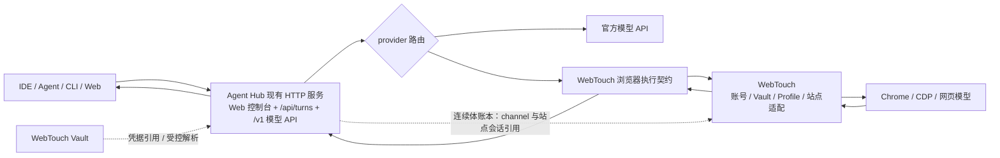

# Agent Hub 模型网关与 WebTouch 浏览器边界

> 状态：`ACTIVE`（2026-10-03 用户定案；迁移进行中）
> 本文是 Agent Hub 与 WebTouch 之间模型入口、连续体、网站身份及浏览器执行边界的唯一事实源。

## 职责归属

| 能力 | Owner | 说明 |
|---|---|---|
| 面向 IDE、Agent、CLI 与 Web 客户端的模型 API（含旧 `/v1/text` 轻量兼容入口） | Agent Hub | Hub 是唯一对外模型 API 网关，管理 OpenAI 兼容入口、文本直通入口、provider/model 路由、策略与统一响应。 |
| 智能体连续体 | Agent Hub | CLI 与 Web 共用 Hub 连续体；Hub 持有对话历史、Lord、上下文、续聊状态，以及远端站点会话引用。 |
| 官方模型 API | Agent Hub | Hub 负责路由 DeepSeek、OpenAI、Gemini 等 provider；密钥的保存与管理归 WebTouch Vault，Hub 只消费受控凭据引用，不建立第二份 Vault。已支持 `credential_ref` 委托 WebTouch CLI 解引用；未配置引用时兼容环境变量/OAuth。真实凭据引用配置尚未验收。 |
| 网站、网站账号与凭据 | WebTouch | 网站目录、登录态、凭据 Vault 以及账号到浏览器 Profile/指纹的绑定均由 WebTouch 持有。 |
| 浏览器执行与网页模型适配 | WebTouch | 管理 Chrome/CDP、网页会话、站点对话恢复、页面内发送/流读取、站点错误分类、限频和账号熔断。 |

Hub 的会话账本保存模型历史、稳定的 `provider/channel` 和 `site_conversation_id`；不保存账号凭据、账号标识或 Profile 内容。WebTouch 的 channel 配置指向其本地账号标识，再由 WebTouch 身份注册表解析已绑定的 Profile 并复用浏览器身份。新 Hub 对话沿用同一 channel；禁止为同一网站账号自动创建新的指纹身份。

Agent Hub 已有常驻 HTTP 服务与 Web 控制台，不需要另建服务。托管连续体应通过 `POST /api/turns` 和稳定、隔离的 `session_key` 恢复对话历史及站点会话 ID。标准 `/v1/chat/completions` 与 `/v1/responses` 是无状态模型 API：客户端自行携带消息历史。控制台聊天面板已接入 `/api/turns`，以随机会话键区分对话；本地保存会话键列表，刷新或切换时从 Hub 读取历史。Cog 检索与状态入口保留，自动记忆沉淀未新增；WebTouch 页签与 Cog 长期记忆不替代 Hub 对话账本。

## 调用拓扑

Agent Hub 对客户端提供模型协议与托管连续体入口；Hub 到 WebTouch 使用浏览器执行契约。该契约可以承载模型轮次数据，但不得承担全局 provider 目录、官方 API 路由或客户端入口职责。WebTouch 的站点级节流、账号熔断及“已派发但结果未知”判据必须在 WebTouch 执行边界生效。账号与 Profile/指纹绑定由 WebTouch 保存并解析；Hub 连续体只保存稳定 channel 和站点会话引用，不接触账号标识，也不因新建 Hub 对话而创建新指纹。

模型网关直接挂载在 Agent Hub 当前 HTTP 服务中，与 Web 控制台、`/api/turns` 共用服务进程和生命周期；不新增独立网关服务或端口。

## 迁移约束

1. Agent Hub 提供客户端入口与模型目录；WebTouch 旧通用模型路径返回 `410 gateway_moved`，客户端调用方统一迁至 Hub。
2. WebTouch 旧路径改为 Hub 专用的浏览器 provider 执行接口；账号、Vault、Profile/指纹绑定、浏览器生命周期和站点安全逻辑留在 WebTouch。
3. Hub 的 Web Continuum 通过稳定 `session_key` 持久化跨请求对话历史及站点会话 ID；已有 Web 控制台需接入该账本并能恢复对话。长期记忆可由 Cog 提供，但不替代轮次历史。WebTouch 只持有浏览器执行所需的本地会话、账号和 Profile 绑定，不复制 Hub 对话历史。
4. 所有消费者迁至 Agent Hub 后，停用 WebTouch 通用模型 API 门面和对外 OpenAI 兼容职责。WebTouch 的浏览器 provider 接口继续由 Hub 内部调用。
5. Hub 模型目录中的 `provider/model` 在发往 provider 前拆为路由和真实模型名；显式 `provider` 与模型前缀冲突时返回 400。流式事件、站点会话引用及 provider 的错误体和 `Retry-After` 原样透传。文本兼容入口保留原请求/响应字段，排队和解析仅在 Hub 实现；WebTouch 不保留旧文本门面及其专属闸门。
6. `models.json` 的 provider 可配置 `credential_ref: "@vault:<条目名>"`。Hub 通过本地 WebTouch CLI `uws vault get <条目名>` 解引用，`AHUB_WEBTOUCH_BIN` 可指定该 CLI；明文仅在子进程管道及 Hub 请求内存存在，不进入 argv、日志、响应或新凭据文件。配置引用时读取失败须拒绝请求，不回退其他密钥；未配置引用的现有环境变量/OAuth 解析保留兼容。Vault 文件的存储、加密和管理仍由 WebTouch 所有。
7. Web 控制台为每个浏览器工作区生成随机 `web:console:<UUID>` 会话键，保存在本地浏览器存储；发送走 `POST /api/turns`，恢复走 `GET /api/turns?session_key=...`（返回 `session_key/messages/summary/updated_at`）。新对话仅切换新键，不删除旧账本或站点对话。Web 对话不自动执行工具；保留 Cog 长期记忆检索和状态入口，其自动沉淀仍属 Cog 能力，不以 Hub 轮次账本冒充长期记忆。Cog 不可用不阻断 Hub 对话。
8. Hub 连续体和连接器回退只重试可证明未提交的失败：provider 明确返回 `error.retryable=true`，或 HTTP 请求在建立连接时失败。`retryable=false`、缺少标记的 provider 错误、连接已建立后断流及 `submission_outcome_unknown` 均不得重放；Hub 模型门面本身不自动重发。

## 当前实现与验收边界

实现和本次运行验收唯一记录见 [迁移案卷](evidence/pilots/2026-10-03-model-gateway-migration.md)，任务状态见 [T-API-GW-01](../Tasks.md#t-api-gw-01-agent-hub-接管客户端模型-api-网关)。模型门面、Web 连续体与 Vault 引用代码已接线部署；真实网页轮次、真实账号/Profile 配置和真实 Vault 引用仍未验收。

WebTouch provider 应用层不直接依赖 `pkg/engine`，但仍使用 `pkg/browser/modelbridge`、`pkg/fingerprint`、`pkg/contract` 与引擎 RPC 类型，并持有站点会话和安全状态；整体 `git mv` 会迁走浏览器执行职责。客户端模型门面因此由 Agent Hub `internal/gateway/` 承接，浏览器执行保留在 WebTouch。

WebTouch `channels.json.account_id` 由身份注册表解析已绑定 Profile；未绑定拒绝创建会话，禁止静默生成另一指纹。该配置仅用于 WebTouch 自管隔离浏览器；`attach-cdp` 的身份由所附 Chrome 决定，不能同时配置 account_id。当前默认服务仍用 attached Chrome，未配置账号映射。
