# WebTouch 商业级指纹浏览器工程蓝图与再造 Checklist
> **Universal Web Surrogate (UWS) / WebTouch Architecture Blueprint & Reproduction Checklist**
> 
> 版本：v1.6.0  
> 状态：生产架构规范与工程复刻唯一指南  
> 适用场景：高对抗环境下的浏览器自动化、多账号隔离、防关联指纹伪装、跨设备无损状态恢复。

---

## 目录
1. [设计哲学：为什么不走自编译 Chromium 路线？](#1-设计哲学为什么不走自编译-chromium-路线)
2. [六层纵深防御体系全景架构](#2-六层纵深防御体系全景架构)
3. [核心防御层与关键技术实现深度剖析](#3-核心防御层与关键技术实现深度剖析)
   - [3.1 网络层与 WebRTC 真实 IP 封死机制](#31-网络层与-webrtc-真实-ip-封死机制)
   - [3.2 自动化特征清除与 CDP 原生性隐身](#32-自动化特征清除与-cdp-原生性隐身)
   - [3.3 JavaScript 原型链与 Native 方法完全克隆](#33-javascript-原型链与-native-方法完全克隆)
   - [3.4 硬件环境与 Client Hints 强自洽矩阵](#34-硬件环境与-client-hints-强自洽矩阵)
   - [3.5 确定性 PRNG 渲染噪声 (Canvas / Audio / WebGL)](#35-确定性-prng-渲染噪声-canvas--audio--webgl)
   - [3.6 会话状态持久化与分布式单写者租约 (State Bundle & Lease)](#36-会话状态持久化与分布式单写者租约-state-bundle--lease)
   - [3.7 原生无干扰 Viewer 壳设计 (Zero-Intrusion Shell)](#37-原生无干扰-viewer-壳设计-zero-intrusion-shell)
4. [官方原生 Chrome 非编译方案的实战避坑秘籍](#4-官方原生-chrome-非编译方案的实战避坑秘籍)
5. [从零再造商业级指纹浏览器：全景工程 Checklist (40+ 项)](#5-从零再造商业级指纹浏览器全景工程-checklist-40-项)
6. [验收命令集与验证标准](#6-验收命令集与验证标准)

---

## 1. 设计哲学：为什么不走自编译 Chromium 路线？

市面上常见的防关联浏览器开发往往有两种路线：
1. **源码魔改编译路线（如 Multilogin / AdsPower / 花仙子）**：下载 Chromium 源码，在 C++ 层面修改 `Navigator`、`WebRTC`、`Canvas` 渲染流水线，然后编译出定制的二进制包分发给用户。
2. **原生 Chrome 注入与管控路线（WebTouch 路线）**：直接驱动目标操作系统官方签名的标准 Google Chrome，通过「启动时文件偏好预置 + 命令行精准配比 + CDP 深度隔离 + 注入上下文原型链 Native 级 Hook + 原生系统级独立 Viewer 壳」实现指纹伪装。

### 路线对比与 WebTouch 的权衡抉择

| 维度 | 源码魔改编译 Chromium | 原生 Chrome + 偏好/CDP/Native Hook (WebTouch) |
| :--- | :--- | :--- |
| **二进制体积与分发** | 极其庞大（单个平台解压后 >300MB），跨平台维护成本极高 | 零额外体积，直接复用宿主环境已有的官方 Chrome |
| **版本跟进时效** | 滞后主流 Chrome 2~6 个月，容易因内核版本陈旧触发外站风控降级 | 100% 同步用户本机 Chrome 最新稳定版，零版本脱节 |
| **TLS/JA3/JA4/HTTP2 特征** | 易因自定义编译开关或第三方魔改破坏 BoringSSL 默认密码套件握手序列 | **100% 纯正官方 Chrome 密码套件与 HTTP/2 帧协商特征**，天然免疫网络层指纹识别 |
| **系统签名与安全机制** | 缺乏 Google 官方签名，macOS Gatekeeper 弹安全警告，Widevine DRM / 安全沙箱易被破坏 | 原生具备 Apple / Microsoft 官方证书背书，DRM/沙箱完全合规 |
| **工程实现难度** | 难在 C++ 编译链搭建与合并上游 upstream 分支 | **难在对官方 Chrome 内部加载时序、Profile Preferences 存储层、CDP 挂载点以及 JS 原型链深层机制的极致掌控** |

**WebTouch 的结论**：只要在「启动时文件持久层」、「CDP 早期注入时序」与「JS 原型链 Native 模拟」上做到严丝合缝，原生 Chrome 路线不仅能完全达到自编译 Chromium 的伪装效果，还能在 TLS 密码协商、DRM 证书和升级时效上实现降维打击。

---

## 2. 六层纵深防御体系全景架构

WebTouch 将指纹防御自底向上划分为六层，每一层均有明确的职责边界和防御目标：

```mermaid
graph TD
    subgraph L1["L1: 网络与传输隔离层 (Network & Transport)"]
        N1[SOCKS5h 远端 DNS 解析]
        N2[Default/Preferences WebRTC 策略]
        N3[出口冲突检测 1:1 绑定]
    end

    subgraph L2["L2: 浏览器标识与视口自洽层 (Identity & Environment)"]
        I1[UA 与 Low-Entropy / High-Entropy UA-CH 严格匹配]
        I2[时区 Emulation.setTimezoneOverride 与 Intl 联动]
        I3[语言 Accept-Language 与 navigator.languages]
        I4[屏幕尺寸与视口比例强校验]
    end

    subgraph L3["L3: 自动化特征消除与反探测层 (Anti-Automation Stealth)"]
        A1[--disable-blink-features=AutomationControlled]
        A2[cdc_ 符号及特征链清洗]
        A3[防止 CDP Console / Runtime 探针挂钩]
    end

    subgraph L4["L4: 原型链与 Native 伪装层 (Prototype & Native Cloaking)"]
        P1[Navigator.prototype 描述符劫持]
        P2[makeNative 封装 Function.prototype.toString]
        P3[hasOwnProperty 与 Symbol.toStringTag 对齐]
        P4[iframe 与 Worker 环境全量传播继承]
    end

    subgraph L5["L5: 确定性渲染噪声层 (Deterministic Noise Injection)"]
        R1[基于 Profile ID 种子生成 PRNG 发生器]
        R2[Canvas 2D toDataURL / getImageData 像素级微扰]
        R3[AudioContext / AnalyserNode 频域微小扰动]
        R4[WebGL Vendor / Renderer 显卡欺骗]
    end

    subgraph L6["L6: 会话持久化与分布式租约层 (State & Lease Security)"]
        S1[State Bundle AES-256-GCM 凭证全状态落盘]
        S2[导航前 Pre-Navigation 状态注入]
        S3[分布式 LeaseToken 单写者互斥租约]
        S4[Native macOS Viewer 零抢焦点无感交互]
    end

    L1 --> L2 --> L3 --> L4 --> L5 --> L6
```



---

## 3. 核心防御层与关键技术实现深度剖析

### 3.1 网络层与 WebRTC 真实 IP 封死机制

#### 3.1.1 致命的 WebRTC UDP 旁路泄漏
在配置代理（如 `--proxy-server="socks5://127.0.0.1:1080"`）时，几乎所有开发者都会遇到真实公网 IP 泄漏的问题：
- **原因**：Chrome 内核原生自带的 SOCKS5 实现仅支持 TCP 转发，**不支持 UDP ASSOCIATE**。
- **后果**：当网页通过 WebRTC API（如 `RTCPeerConnection`）发起 STUN 请求收集 ICE 候选者时，Chrome 无法通过 SOCKS5 发送 UDP 包，内核默认行为是**回退到本机的物理网络接口（Wi-Fi 或以太网卡）直接对外发送 UDP 探测**！目标 STUN 服务器直接捕获到本机的真实宽带 IP，造成秒级穿透。

#### 3.1.2 官方 Chrome 的命令行失效大坑
曾经在早期 Chromium 中可以通过 `--force-webrtc-ip-handling-policy=disable_non_proxied_udp` 规避。但在 Chrome 120+，尤其是最新稳定版（如 Chrome 152.0.7977.83 实测）中：
**该命令行参数在有头或带 profile 启动时根本不会生效！**
外站（如 BrowserLeaks WebRTC 模块）依然能够轻而易举探测出用户的真实 ISP 分配的公网 IPv4/IPv6。

#### 3.1.3 WebTouch 的终极焊死方案：Profile Preferences 持久层预置
Chrome 在启动时，会最先读取其 Profile 根目录（如 `<profile_dir>/Default/Preferences`，JSON 格式）。这是 Chrome 内部的权威配置中心。

**实现逻辑**（详见 `pkg/browser/cdp_session.go` 中的 `seedChromePreferences` 与 `updateChromePreferences`）：
1. 在拉起 Chrome 二进制进程之前，先用文件操作检查并创建 `<profile_dir>/Default/` 目录。
2. 读取或初始化 `Preferences` 文件，注入或增量合并：
   ```json
   {
     "webrtc": {
       "ip_handling_policy": "disable_non_proxied_udp"
     },
     "translate": {
       "enabled": false
     }
   }
   ```
3. **策略含义**：`disable_non_proxied_udp` 强制 Chrome 禁止任何不经过代理的 UDP 流量。既然 SOCKS5 代理无法承载 UDP，Chrome 就彻底阻断物理网卡的直连探测，外站 STUN 探测不到任何 candidate，显示为 `WebRTC Disabled / No Leak`。
4. **增量更新**：如果该 profile 已经有用户保存的账号数据或扩展，只解析最外层 JSON，对 `webrtc` 和 `translate` 做局部修改，其余字段绝不覆盖。

---

### 3.2 自动化特征清除与 CDP 原生性隐身

自动化程序被外站捕获，90% 是死在以下几个低级特征：

1. **`navigator.webdriver` 为 `true`**：
   - 解决方案：启动参数强制加上 `--disable-blink-features=AutomationControlled`。该参数直接让 Blink 引擎在 C++ 层不初始化 `navigator.webdriver` 属性，`navigator.webdriver === undefined`，比任何 JS 层 hook 都更彻底。
2. **ChromeDriver 的 `cdc_` 变量污染**：
   - 如果使用原生 chromedriver，其会在 `document` 或全局对象挂载形如 `cdc_adoQpoasnfa76pfcZLmcfl_Array` 的变量。WebTouch 采用纯原生 CDP WebSocket 直连，完全不经过 chromedriver 驱动，从根源上消除了 `cdc_` 污染。
3. **CDP 探针防范**：
   - 商业反爬脚本（如 Cloudflare Turnstile、DataDome）会通过构造故意报错并重载 `Error.prepareStackTrace` 来检查调用栈中是否潜伏 DevTools 内部协议。
   - WebTouch 的注入脚本运行在最高权限的孤立世界（Isolated Context）或通过 `Page.addScriptToEvaluateOnNewDocument` 保证在页面任何业务脚本加载前的 Microtask 阶段完成就绪，且不留任何全局可枚举辅助对象。

---

### 3.3 JavaScript 原型链与 Native 方法完全克隆

许多自制脚本的致命破绽在于用简单的 JavaScript 闭包伪造属性：
```javascript
// ❌ 业余做法：极其脆弱，秒被识别
navigator.platform = "MacIntel"; 
Object.defineProperty(navigator, 'webdriver', { get: () => false });
```
外站检测只需一行代码即可破解：
```javascript
navigator.hasOwnProperty('platform'); // 返回 true！而正常 Chrome 返回 false，因为属性在原型链上！
navigator.__proto__.hasOwnProperty('platform'); // 正常 Chrome 应该为 true
navigator.platform.toString(); // 抛异常或返回普通函数字符串，而不是 "function () { [native code] }"
```

#### WebTouch 的工业级原型链伪装实现 (`pkg/fingerprint/hook.go`)：

1. **统一的 `makeNative` 工厂函数**：
   所有伪造的函数、Getter、Setter 均由 `makeNative` 处理，拦截 `Function.prototype.toString`：
   ```javascript
   const nativeMap = new WeakMap();
   function makeNative(targetFn, name) {
     nativeMap.set(targetFn, `function ${name || targetFn.name || ''}() { [native code] }`);
     return targetFn;
   }
   // 挂钩 Function.prototype.toString
   const originalToString = Function.prototype.toString;
   Function.prototype.toString = makeNative(function toString() {
     if (nativeMap.has(this)) return nativeMap.get(this);
     return originalToString.call(this);
   }, 'toString');
   ```
2. **原型链挂载规则**：
   - `platform`、`hardwareConcurrency`、`deviceMemory` 等必须定义在 `Navigator.prototype` 上，而非 `window.navigator` 实例本身。
   - `configurable: true`, `enumerable: true`, `get: makeNative(...)`，确保属性描述符与真机一模一样。
3. **多执行环境全量覆盖**：
   - 主文档、子 Iframe（无论是同源还是 `about:blank`）必须保证在 DOMContentLoaded 前全部生效。
   - Web Worker / Service Worker 独立线程中，通过在创建时自动拦截并注入相应属性。

---

### 3.4 硬件环境与 Client Hints 强自洽矩阵

反欺诈系统对多维度指纹的自洽性校验极严，任何逻辑冲突都会被判定为高危（Bot）：
- **冲突示例**：UA 宣称是 `Windows NT 10.0`，但 `navigator.platform` 却是 `MacIntel`；或者 UA 宣称是桌面版 Chrome，但 `Sec-CH-UA-Mobile` 却是 `?1`。

WebTouch 实现了**严格自洽矩阵校验器**（`pkg/fingerprint/profile.go`）：
1. **UA 与 Client Hints 联动校验**：
   - 档案必须包含 `UserAgentMetadata`（高熵与低熵）。
   - 如果 UA 包含 `Windows`，则 `Platform` 强制为 `Windows`，`Sec-CH-UA-Platform` 为 `"Windows"`。
   - 桌面端配置如果出现 `mobile: true`，直接在启动时拒绝加载（Fail-Closed）。
2. **时区与语言联动**：
   - 时区不能只改操作系统环境变量，必须通过 CDP `Emulation.setTimezoneOverride` 锁定。
   - 时区、`Intl.DateTimeFormat().resolvedOptions().timeZone` 与代理 IP 的所在地理位置必须同属同一时区大区。
   - `navigator.languages` 与 HTTP 请求头 `Accept-Language` 保持顺序与权重 100% 一致。
3. **屏幕尺寸与视口**：
   - `screen.width`、`screen.height`、`screen.availWidth`、`screen.availHeight` 与 `window.innerWidth`、`window.innerHeight` 的物理关系必须自洽：
     - `availHeight <= height`
     - `innerHeight <= outerHeight <= availHeight`
   - 坚决杜绝无头模式下常见的 `outerWidth === 0` 或 `outerWidth < innerWidth` 破绽。

---

### 3.5 确定性 PRNG 渲染噪声 (Canvas / Audio / WebGL)

指纹追踪算法（如 FingerprintJS Pro）利用不同显卡驱动在渲染同一段复杂字体和 3D 图形时的浮点舍入差异来计算设备唯一 Hash。

#### 3.5.1 为什么随机噪声是自寻死路？
很多脚本在 `toDataURL` 时随机给一个像素修改 RGB 值。这种纯随机是自杀：
- **同会话内刷新**：正常真实用户的 Canvas 无论刷新多少次，其哈希值绝对是 **100% 恒定不变** 的。
- 如果用户刷新页面或脚本两次计算 Canvas 哈希，发现每次都不一样，风控系统立即判定为：**该客户端正在使用自动化指纹随机化插件（Poisoning Attack）**，风控直接拉满。

#### 3.5.2 WebTouch 的确定性噪声算法
1. **基于 Profile ID 的稳定种子**：
   每个独立身份档案在初始化时派生出一个确定性的 32 位整型种子（Seed）：
   `seed = MurmurHash3(profile_id + salt)`。
2. **轻量 PRNG (伪随机数生成器)**：
   采用轻量级 Mulberry32 / Xoshiro 算法。同一个 profile 在同一个页面渲染同一幅图时，PRNG 生成的微扰序列完全一致；但不同 profile 之间的微扰序列完全不同。
3. **最低有效位微扰 (LSB Perturbation)**：
   - **Canvas 2D**：拦截 `CanvasRenderingContext2D.prototype.getImageData` 与 `HTMLCanvasElement.prototype.toDataURL`。在提取的像素点上，仅在透明度不为 0 的特定像素点上，对最低有效位（LSB, ±1）进行极微小调整。肉眼完全不可见，但足以改变整张图片的哈希。
   - **Audio**：拦截 `AnalyserNode.prototype.getFloatFrequencyData` 与 `AudioBuffer.prototype.getChannelData`，注入低于 -80dB 的确定性亚感知底噪。
   - **WebGL**：拦截 `WebGLRenderingContext.prototype.getParameter`，针对 `UNMASKED_VENDOR_WEBGL` 和 `UNMASKED_RENDERER_WEBGL` 替换为与档案 Profile 一致的硬件参数（如 `Google Inc. (Apple)`、`ANGLE (Apple, Apple M2 Pro, OpenGL 4.1)`）。

---

### 3.6 会话状态持久化与分布式单写者租约 (State Bundle & Lease)

指纹浏览器必须支持长期稳定的账号维护与跨设备无缝迁移，但传统的 Cookie 导出存在巨大安全与一致性隐患。

#### 3.6.1 全状态包 (State Bundle) 的安全规范
WebTouch 状态包不仅包含 Cookie，还包含 LocalStorage 和 SessionStorage：
1. **全密文落盘**：状态包文件使用 AES-256-GCM 进行对称加密，落盘文件权限强制限于 `0600`。
2. **Pre-Navigation 注入时序铁律**：
   - **Cookie**：在页面导航前通过 CDP `Network.setCookies` 一次性预置。
   - **LocalStorage**：由于 LocalStorage 严格按 Origin 隔离，必须在页面导航前、DOM 尚未执行任何脚本时，通过 CDP `Page.addScriptToEvaluateOnNewDocument` 注入到目标域名命名空间中。
   - **拒绝迟到恢复**：如果页面已经完成首次导航，严禁强行追加导入状态包，必须返回 `FAILED_PRECONDITION` 报错退出，防止登录态竞争导致的数据踩踏。

#### 3.6.2 分布式单写者租约 (Distributed Lease)
- **痛点**：如果两台工作机或两个并发任务误操作同时挂载同一个 profile 启动，目标站点（如 Amazon / Google）会瞬间收到来自两个不同 IP 的并发会话，直接触发账号风控封号。
- **实现机制**：
  1. 提供独立的租约控制协调器（`cmd/uws-lease`），支持成对 mTLS 传输保护。
  2. 启动 Chrome 前必须向协调器申请 `LeaseToken`（附带 TTL 与心跳机制）。
  3. 只有持有有效 Token 的节点才具有 Profile 的唯一写入权限；如果网络中断或租约超时未续期，关联的浏览器会话立即自锁（Fail-Closed）并退出，杜绝脏数据写入。

---

### 3.7 原生无干扰 Viewer 壳设计 (Zero-Intrusion Shell)

#### 3.7.1 痛点：传统自动化的焦点侵扰
传统自动化工具（Puppeteer、Selenium）在本地执行时，会频繁弹出大尺寸 Chrome 窗口、抢占操作系统的鼠标与键盘焦点，导致正在打字的用户按键被打乱，极度恶劣。

#### 3.7.2 WebTouch 的原生无干扰设计 (`cmd/viewer`)
1. **尺寸压缩与后台化运行**：
   - 有头 Chrome 启动参数默认设置小尺寸窗口（`360×540`），位置固定于屏幕次级角落。
   - 通过 CDP `Target.createTarget{newWindow: true, background: true, focus: false}` 启动，永不触发系统级窗口前台抢占。
2. **Swift AppKit 原生查看壳**：
   - 独立开发 macOS 原生壳（`cmd/viewer/`），采用 `NSPanel`（子类化为 `NonActivatingPanel`）。
   - 该面板设置了 `NSWindow.CollectionBehavior.transient`，**无法成为系统 Main Window 或 Key Window**，彻底丧失抢焦点的能力。
3. **CDP Screencast 零污染帧传输**：
   - Viewer 绝不使用内嵌 WebView（WebView 会引入第二套浏览器指纹），也不在页面 DOM 中注入任何辅助悬浮窗。
   - 直接通过 CDP 协议中的 `Page.startScreencast` 监听真实页面的 JPEG 画面流，通过系统底层的 `CALayer` 渲染帧，虚拟光标与点击涟漪全部由原生 Swift 在画面上层独立绘制。

---

## 4. 官方原生 Chrome 非编译方案的实战避坑秘籍

在数千次外站真实对抗和回归测试中，我们总结出了以下 5 条血泪避坑法则：

### 避坑 1：命令行 Flags 并非万能，务必以 Preferences 文件层为准
- **坑点**：Google Chrome 团队在近年来的重构中，大量淘汰了原有的实验性命令行 Flags（例如 `--force-webrtc-ip-handling-policy`、`--disable-features=Translate` 在部分环境无响应）。
- **秘籍**：Chrome 启动时读取文件持久层的逻辑是写死在 C++ 内核主干中的。所有与网络策略、默认功能相关的配置，**务必直接在 `<profile_dir>/Default/Preferences` 中进行增量 JSON 写入**，这是 100% 必定生效的底层持久层。

### 避坑 2：SOCKS5 代理必须阻断物理网卡 UDP 泄漏
- **坑点**：挂了代理却在 BrowserLeaks 上被抓出现实宽带 IP。
- **秘籍**：SOCKS5 协议标准虽有 UDP 扩展，但 Chrome 官方客户端从未支持通过 SOCKS5 转发 WebRTC UDP。不要妄想让 Chrome 通过 SOCKS5 传输 STUN 包，唯一的正确解法是将 `webrtc.ip_handling_policy` 设为 `disable_non_proxied_udp`，彻底焊死非代理 UDP。

### 避坑 3：严禁使用 `--headless=new` 假装真实设备
- **坑点**：无头模式性能高，很多开发者喜欢在外站检测时用 headless。
- **秘籍**：现代化反爬引擎（如 Cloudflare / DataDome）在前端使用 50+ 个维度检测无头模式：
  1. `outerWidth === 0` 或 `outerHeight === 0`；
  2. 即使伪造了尺寸，`outerWidth < innerWidth` 也会直接出卖环境；
  3. 无头模式默认缺少完整的 WebGL 驱动扩展。
  **结论**：不要在核心生产业务中使用无头模式。WebTouch 采用「小尺寸有头 + 焦点剥离 + 坐标归一化」方案，既保留了 100% 真实显卡渲染和物理窗口行为，又完全不打扰用户。

### 避坑 4：必须主动消灭 Chrome 的原生“翻译此页”气泡
- **坑点**：在无地址栏的 App 模式或小窗口自动化时，访问外文网站，Chrome 会强制在视口中央弹出一个原生 `Translate` 悬浮小气泡。
- **秘籍**：该气泡会遮挡页面核心按钮，导致坐标点击完全失效。必须在启动前通过 `Preferences` 写入 `{"translate": {"enabled": false}}`。

### 避坑 5：SOCKS5 与 SOCKS5h 的致命区别（DNS 泄漏）
- **坑点**：使用 `socks5://host:port` 代理时，域名的 DNS 解析依然发生在本机物理网卡，导致目标站点的 CDN 节点分配到你的本地真实 IP 归属地。
- **秘籍**：在代理协议解析层，必须自动将 `socks5://` 规约为 `socks5h://`（或将主机名传给代理端解析），确保 DNS 查询 100% 发生在远端出口节点。

---

## 5. 从零再造商业级指纹浏览器：全景工程 Checklist (40+ 项)

后续任何工程师或团队根据此清单，可逐项自检、复刻出同等水准的工业级指纹浏览器。

### 一、 浏览器启动与底层偏好 (Launch & Preferences)
- [ ] **[CHK-01]** Chrome 启动前预检并创建 `<profile_dir>/Default` 目录。
- [ ] **[CHK-02]** 在 `<profile_dir>/Default/Preferences` 中预置 `translate.enabled = false`，杜绝翻译弹窗。
- [ ] **[CHK-03]** 在 `Preferences` 中预置 `webrtc.ip_handling_policy = "disable_non_proxied_udp"`。
- [ ] **[CHK-04]** 针对既有 `Preferences` 执行增量 JSON 合并，不得抹除已有用户数据和登录态。
- [ ] **[CHK-05]** 启动参数包含 `--disable-blink-features=AutomationControlled`，彻底清除 `navigator.webdriver`。
- [ ] **[CHK-06]** 启动参数包含 `--no-first-run`、`--no-default-browser-check`，禁止首次引导弹窗。
- [ ] **[CHK-07]** 统一指定 `--window-size=360,540`，启动模式设为后台静默创建。

### 二、 网络传输、代理与 WebRTC 隔离 (Networking & WebRTC)
- [ ] **[CHK-08]** 支持 SOCKS5h / HTTP 代理，禁止明文在启动日志和报错中打印代理账密。
- [ ] **[CHK-09]** 自动将 `socks5://` 规约为带远端 DNS 解析的格式，防止本机 DNS 泄漏。
- [ ] **[CHK-10]** 建立账号↔身份↔代理出口 1:1 强绑定映射表，严禁多身份共用单一代理出口。
- [ ] **[CHK-11]** 跨进程文件锁（`flock`）保护注册表文件，防止并发读写竞态。
- [ ] **[CHK-12]** WebRTC 泄漏终极验收：BrowserLeaks WebRTC 检测项无真实公网 IP。

### 三、 自动化特征抹除与原生原型链伪装 (Stealth & Prototype)
- [ ] **[CHK-13]** 不使用 ChromeDriver，采用全原生 CDP WebSocket 协议直连，杜绝 `cdc_` 变量。
- [ ] **[CHK-14]** 封装 `makeNative`，确保所有被劫持函数的 `toString()` 返回 `function () { [native code] }`。
- [ ] **[CHK-15]** `Function.prototype.toString.call(fn)` 同样返回 `[native code]`，不留破绽。
- [ ] **[CHK-16]** 伪造属性全部挂载于 `Navigator.prototype` 或目标 Prototype，保持 `navigator.hasOwnProperty(...) === false`。
- [ ] **[CHK-17]** 属性描述符精确对齐：`configurable: true`, `enumerable: true`, `writable: false`（若原属性为 getter）。
- [ ] **[CHK-18]** 注入代码必须在 `Page.addScriptToEvaluateOnNewDocument` 阶段执行，优先于任何外部业务脚本。
- [ ] **[CHK-19]** 确保伪装逻辑在 `iframe`（包括 `src="about:blank"`）和新建标签页中全自动生效。

### 四、 硬件环境与 Client Hints 强自洽 (Environment & Client Hints)
- [ ] **[CHK-20]** UA 与 Client Hints（`Sec-CH-UA`, `Sec-CH-UA-Platform`, `Sec-CH-UA-Model`）100% 自洽。
- [ ] **[CHK-21]** 桌面环境严格断言 `Sec-CH-UA-Mobile: ?0`，杜绝桌面 UA 冒充手机的自相矛盾。
- [ ] **[CHK-22]** `navigator.platform` 与操作系统内核（`MacIntel`, `Win32`, `Linux x86_64`）严格吻合。
- [ ] **[CHK-23]** 硬件并发度 `hardwareConcurrency` 取值合理（4, 8, 12, 16 等），杜绝奇数或异常数值。
- [ ] **[CHK-24]** 内存容量 `deviceMemory` 伪装匹配（4, 8, 16），符合 Chrome 标准规范。
- [ ] **[CHK-25]** 通过 CDP `Emulation.setTimezoneOverride` 同步时区，并保证与代理 IP 物理地理位置一致。
- [ ] **[CHK-26]** `Intl.DateTimeFormat().resolvedOptions().timeZone` 与系统时区一致。
- [ ] **[CHK-27]** `navigator.languages` 与 HTTP 头 `Accept-Language` 语言顺序与权重完全对齐。
- [ ] **[CHK-28]** 屏幕几何尺寸强校验：`availHeight <= height` 且 `innerHeight <= outerHeight <= availHeight`。

### 五、 确定性渲染与声学噪声 (Rendering & Audio Noise)
- [ ] **[CHK-29]** 为每个 Profile 派生唯一的 32 位整型 Seed，严禁使用 `Math.random()` 注入无序噪声。
- [ ] **[CHK-30]** 同一 Profile 在多次会话、多次刷新后，Canvas 2D 哈希值必须保持 100% 绝对一致。
- [ ] **[CHK-31]** 不同 Profile 之间的 Canvas 2D 哈希值必须产生明确分歧。
- [ ] **[CHK-32]** Canvas 2D 微扰仅在最低有效位（LSB, ±1）进行，不影响视觉呈现。
- [ ] **[CHK-33]** AudioContext 频域注入确定性微小底噪，跨刷新音频指纹不变，跨身份音频指纹分歧。
- [ ] **[CHK-34]** WebGL `UNMASKED_VENDOR` 与 `UNMASKED_RENDERER` 与档案显卡参数保持一致。

### 六、 会话状态持久化与分布式租约 (State Bundle & Lease)
- [ ] **[CHK-35]** State Bundle 采用 AES-256-GCM 强加密存储，落盘文件权限设置为 `0600`。
- [ ] **[CHK-36]** 状态包导出必须完整包含 Cookies、LocalStorage 与 SessionStorage。
- [ ] **[CHK-37]** 状态恢复必须在 Pre-Navigation 阶段完成；首次导航后禁止迟到恢复（Fail-Closed）。
- [ ] **[CHK-38]** 独立 Lease 协调服务支持 TLS 传输加密，拒绝跨网络明文租约传输。
- [ ] **[CHK-39]** 租约具有 TTL 心跳机制，租约失效时本地会话立即自锁退出，杜绝多节点双写冲突。

### 七、 原生无干扰交互与真实环境验证 (UX & Verification)
- [ ] **[CHK-40]** 原生 Viewer 壳（如 macOS AppKit `NSPanel`）子类化，剥离 Key/Main 窗口能力，永不抢焦点。
- [ ] **[CHK-41]** Viewer 通过 CDP Screencast 获取画面帧，严禁使用任何内嵌 WebView，防止指纹二次污染。
- [ ] **[CHK-42]** 通过开源与商业反爬外站全项验收：
  - [bot.sannysoft.com](https://bot.sannysoft.com/)：`HEADCHR_UA`、`webdriver` 等核心项全绿通过。
  - [browserleaks.com](https://browserleaks.com/)：Canvas、WebGL、WebRTC、Fonts 检测项自洽且无泄漏。
  - [creepjs](https://abrahamjuliot.github.io/creepjs/)：无 Prototype 篡改标记、无 Worker 穿透破绽。

---

## 6. 验收命令集与验证标准

在构建完上述系统后，使用以下命令集执行逐层硬核验收：

### 1. 单元测试与底层 Preferences 验证
```bash
# 验证 WebRTC 偏好注入与增量合并逻辑（0 毫秒静默运行）
go test ./pkg/browser -run "TestSeedChromePreferences|TestUpdateChromePreferencesIdempotent" -v

# 验证指纹配置自洽校验与 Hook 脚本生成
go test ./pkg/fingerprint -v
```

### 2. 原生无干扰 Viewer 壳自检 (macOS)
```bash
# 验证 Swift 原生 Panel 窗口与 CALayer 自绘逻辑（56 例测试）
swift test --package-path cmd/viewer
```

### 3. 外站静默审计运行（无头安全验证）
```bash
# 执行全套外站对抗回归审计，生成 JSON 与 Markdown 证据
./scripts/fingerprint_audit.sh --sites sannysoft,browserleaks,creepjs
```

### 4. 验收判定红线
- **硬性通过判据**：
  1. `bot.sannysoft.com` 中 `User Agent (Chrome)` 为 `ok`，`WebDriver (New)` 为 `missing (ok)`。
  2. `browserleaks.com/webrtc` 中，`Local IP Address` 与 `Public IP Address` **不可见真实物理网卡 IP**，必须显示为代理 IP 或 `Disabled`。
  3. `CreepJS` 中，`navigator.webdriver` 评分正常，无 `prototype lie` 报警。
  4. 整个自动化测试与运行周期中，**操作系统前台打字焦点 0 次丢失，0 次弹出原生大窗口**。

---
*文档编制：WebTouch 核心研发团队 · 知识唯一事实源*
