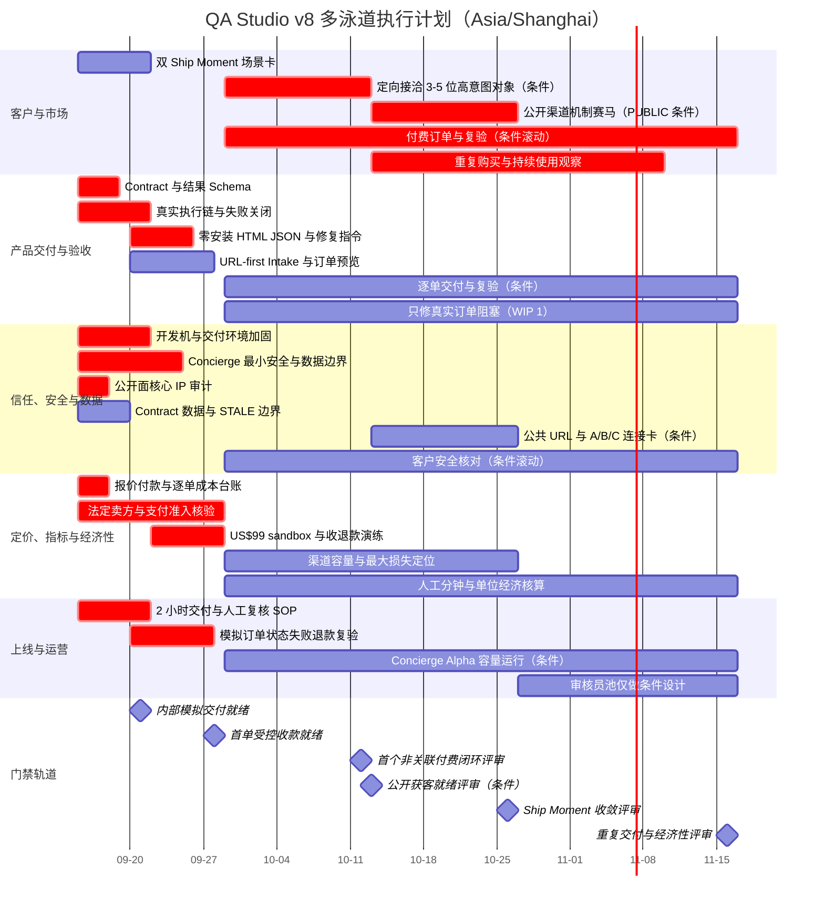

# WebTouch QA Studio 商业与产品运营执行方案 v8

> 状态：2026-09-15 在 v7 受控 Concierge 路径上完成产品入口复审；当前处于 `DRY HOLD / PAID-CONCIERGE HOLD / PUBLIC HOLD`，商业成立尚未被证明。
>
> 本文是 QA Studio **唯一商业与产品运营执行事实源**，统一承载首个外部产品、里程碑、推广与上线、产品验收、定价实验、指标口径、依赖排期、对齐节点、行动清单和研发解锁。原文件路径保留，内容由本文替代。
>
> 所有交付前置条件的逐项状态、具体动作和验收证据见[首单交付准备 Requirement Registry](delivery-readiness-requirements-2026-09-15.md)。Registry 是本计划的细化检查面，不另行定义路线图、价格或里程碑；任一门禁项未通过时，以本文的 `HOLD` 为准。
>
> [商业决策与信任架构](commercial-strategy-and-trust-architecture-2026-09-14.md) 只负责 `Open Edge, Closed Intelligence`、A/B/C 连接、数据边界和核心 IP 边界，不再另行定义商业节奏与价格。v7 的方向输入来自 2026-09-15 Google Docs [《Vibe Coding 验收产品｜产品、商业与增长闭环讨论总结》](https://docs.google.com/document/d/1YUT8U-UBsx2wrWgRsho_JOgfCNTZeSWvoYM8H_m43A8/edit)、[《WebTouch QA Studio｜商业与产品运营执行方案 v5｜唯一事实源》](https://docs.google.com/document/d/1ULRsQQlWnUEoOw7BQ-W7T4TPwwCoStz6p5rjT5tOBE8/edit)、[《商业产品决策认知算子与交付规范》](https://docs.google.com/document/d/1LgY0vHz4O425uYhsXZwzufTUsmlHHKP5PmuZNRY6tzs/edit)，并将受控 Concierge 礼宾模式吸收为首 1–3 单的执行模式。v8 进一步吸收 2026-09-15 的 Map / Skill 产品门槛审查：首单保持 URL-first，不要求源码映射或本地安装；任何增强连接都由付费后的真实摩擦证据解锁。

## 0. 总裁决

当前决策是 **REFRAME → VALIDATE，不是 SCALE**。

产品类别收敛为 **Vibe Coding Acceptance Layer / Last-mile Verification（Vibe Coding 交付验收层）**。WebTouch 不是另一个自动化测试 SaaS；Builder/Coding Agent 负责生成和修改，WebTouch 作为独立 Judge，依据 Acceptance Contract 汇集多个 Evidence Provider 的证据并给出可复核裁决。浏览器、视觉模型、源码/配置、日志、部署和支付状态都只是证据提供者，不等于 Judge 本身。

首个可售实验定义为 **Controlled Concierge Ship Readiness Acceptance Job（受控礼宾式交付就绪验收任务）**：首 1–3 单只通过创始人定向触达或人工接洽进入；客户提交一个经人工核验且明确授权的公开 URL 与一个 Ship Moment，WebTouch 使用真实本地 Runner 与独立浏览器环境执行，由 AI + 人工复核在目标 2 小时内交付静态或受控分享结果，包含 `Readiness Gap + Priority + Evidence + Agent-ready Fix Instructions`，并含交付后 48 小时内可申请的一次同范围人工复验。实验价 **US$99** 仅是支付意愿探针，不是公开长期定价。

**首 1–3 单执行材料坚持“双不”：不要求上传 Source Map，不要求安装 Skill / MCP / Plugin。** 默认交付以可读 HTML、可复制的 Agent-ready Fix Instructions 和最小机器可读结果清单完成 Builder 交接。首轮不得静默发现、额外抓取或留存 `.map`；公开可访问不等于客户同意把源码映射纳入交付数据。只有真实付费任务出现“没有源码定位就无法形成有用修复指令”的高优先级缺口，且客户对范围、保留和删除另行明确同意，才允许在一次复验中做有界 Map 实验。连接器同样只在重复付费与手工交接摩擦出现后评估，并且一次只验证一种最小连接方式。

**首笔付款不再依赖 PUBLIC 门禁。** `PAID-CONCIERGE` 只证明“一个非关联客户可以被人工安全接单、合法付款、收到真实结果并获得退款/复验救济”；公开案例、公开 URL intake、自服务任务创建、自动 Webhook、多租户与规模化归因属于后续 `PUBLIC` 或 `PAID` 门禁。人工审单只能替代公开入口与自动工单系统，不能替代运行时对协议、解析 IP、逐跳重定向、下载和有副作用动作的最小硬阻断。

客户购买的是“现在离可交付还有哪些差距、先修什么、证据是什么、该把什么指令交给编码 Agent”，不是浏览器自动化、WSTN、Acceptance Graph 或报告生成器。原 **Verified PR Acceptance Job** 不再是唯一首发产品；它保留为“1→1.1 生产发布”Ship Moment 下证据更丰富的一种输入/交付路径。

证据门禁的裁决顺序固定如下；工作并不按这七项串行排队，具体并行和滚动规则见 §12：

1. 内部虚构订单能以真实 Runner 完成 Contract → 执行 → 人工复核 → 交付 → 复验，且失败关闭；
2. `PAID-CONCIERGE` 的卖方、收款、人工 Intake、运行安全、交付、退款、证据与逐单台账就绪；
3. 完成首个非关联客户真实付款、限时交付和一次修复/复验闭环；
4. 只有需要公开获客时才通过 `PUBLIC`，开放脱敏案例和陌生 URL intake；该门禁不得反向阻断第 3 步；
5. 用同一 offer 比较“0→1 首次上线”与“1→1.1 生产发布”两个 Ship Moment，并识别可重复的渠道 × 信息组合；
6. 验证重复购买/持续使用、人工交付成本和贡献毛利；
7. 证据成立后才进入 Paid Beta 与 Limited Availability；GA 不预排。

### 0.1 本计划所说的“闭环”

**商业闭环**是：`定向接洽或可归因渠道事件 → offer/案例 → URL 授权与核验 → 订单预览 → 实际付款 → 限时交付 → 修复 → 复验 → 重复购买/持续使用 → 可持续毛利 → 新证据反过来改变产品、定价或获客`。首 1–3 单允许以人工接洽和静态交付物完成左半段；公开阶段再验证案例页和公开 intake。缺少付款、交付、复验/复用或经济回流中的任一环，都只能说“正在验证”，不能说商业成立。

**执行闭环**是：`决策 → 假设 → 依赖 → 行动 → 用户/商业效果 → 原始证据 → 门禁裁决 → 更新同一份计划`。每个开放假设都必须有负责人、日期或证据触发点、证据位置、通过/停止阈值和下一决策。只有任务清单、甘特图或会议节奏都不算闭环。

这套计划目前实现的是“验证路径闭环”，不代表商业闭环已经成立。

### 0.2 本次收敛状态

| 收敛要素 | v8 定案 |
|---|---|
| Reference | 2026-09-15 三份 Google Docs 新讨论；目标是先建立最小增长闭环并取得陌生用户行为与付款证据 |
| State | Level 1/2 与报告能力可用，信任边界已有；旧计划却把 PR、12 人访谈和较晚付款串成唯一首发路径 |
| Gap | 类别仍像测试工具；Builder/Judge 边界、Acceptance Contract、URL→付款→结果→复验漏斗和双 Ship Moment 比较未进入本地计划 |
| Correction | 用一个 URL-first、US$99、2 小时、交付后 48 小时内可申请一次同范围人工复验的 offer 建立可售闭环；首 1–3 单切为受控人工礼宾；把 `PAID-CONCIERGE` 与 `PUBLIC` 解耦；首单不要求 Map 或 Skill/MCP；PR 降为场景分支；保留五泳道并行 |
| Settlement | `REFRAME → VALIDATE`；直到出现真实付款、交付时长、复验行为与单位经济证据，不升级为规模化产品线 |

## 1. 边界、Ship Moment 与购买链

### 1.1 不因商业推进改变的边界

| 项目 | 裁决 |
|---|---|
| 开放策略 | 保留 `Open Edge, Closed Intelligence` |
| 连接方式 | A Cloud Direct、B Thin Runner、C Customer VPC 均为待验证选项，不预设客户偏好 |
| 当前可用能力 | Level 1/2 用于 URL-first 真实案例和付费交付，不扩建通用平台 |
| Level 3 | 只允许服务已付费或强行为证据支持的一条关键链路；只有重复需求证据才产品化 |
| Level 4 | 继续 `HOLD`；没有付费与留存证据不得开发 |
| 信任证据 | 架构文档不是客户信任；客户完成安全核对并真实接入才算 |
| 授权来源 | 仅客户明确配置、审批与运行时策略可以授权动作；PRD 只能表达需求，不能授权执行 |
| 独立性 | Builder/Coding Agent 不得同时担任最终 Judge；Judge 必须显示依据、未覆盖边界和重开条件 |
| 结果生命周期 | 每次验收绑定 URL、版本、时间、环境与范围；任一关键条件变化后原结果标记 `STALE`，不得继续冒充当前结论 |
| 首 1–3 单运行模式 | 人工接洽、人工核验 URL、单单目录隔离、真实本地 Runner、人工复核、静态/受控结果交付、人工原路退款；不建设公开自服务端点 |
| 首单执行材料 | 必填只收经授权的公开 URL、Ship Moment、已接受的 Contract 与可联系身份；版本/提交、最多 3 条页面路径、自定义视口和参考图均为可选；不要求仓库、Source Map 或本地安装 |
| Source Map | 首 1–3 单默认不接收、不主动发现、不额外抓取和不留存；只有真实付费任务证明精确源码定位会改变修复采用，且客户另行同意范围、保留和删除时，才做有界可选实验 |
| Skill / MCP / Plugin | 首单只交付可复制修复指令和最小机器可读结果，不要求安装；重复付费与可测量的手工交接摩擦出现后，才在真实客户环境中一次验证一种最小连接器 |
| 最小 URL 安全 | 人工白名单只负责准入判断；Runner 仍须在连接前与每次重定向时拒绝非 HTTP(S)、凭据 URL、本机/内网/链路本地地址，并禁止下载、登录、真实付款和写动作 |
| Requirement 表达 | Requirement 记录必须成立的结果，不把 `100 GiB`、某个支付商、某种备份产品等单一实现写成不可替代前置；允许以可审计的等效控制满足 |
| 收款路径 | 法定卖方、支付/银行/税务适配是硬前置，但不预设必须使用 Paddle、Stripe 或新公司；以实际准入证据选择 |

### 1.2 两个 Ship Moment 的同 offer 比较

首轮不预先押注单一 ICP，先用完全相同的 offer、价格和交付范围比较两个触发时刻：

| Ship Moment | 纳入条件 | 购买任务假设 | 必须观察的行为 |
|---|---|---|
| 0→1 首次上线 | AI-native 创业者、独立开发者或非技术产品创建者有一个接近首次公开的可访问产品 | 需要知道离“可以给别人看/可以发布”还差什么，并获得可直接交给 Agent 的修复指令 | 案例点击、URL 提交、付款点击/付款、修复、复验 |
| 1→1.1 生产发布 | 小团队、工作室或已有用户的产品正准备一次重要更新/合并 | 需要降低回归与发布风险，并留下可复核证据 | 同上，另记录是否有 PR/版本标识、是否进入发布决策 |

研究与销售使用“广度扫描 → 信息增益排序 → 有限深挖 → 实验 → 回到广度”的循环。12 位合格对象仍可作为首轮研究预算，但不再是开始报价或收款的前置门禁；任何合格陌生用户都可以直接进入同一可售实验。

首轮结束后只保留一个滩头 Ship Moment/ICP 组合：按 `合格访问 → URL 提交 → 实际付款 → 交付接受 → 复验/再次购买 → 支持成本` 的行为证据选择，不按访谈热情选择。熟人与非熟人、0→1 与 1→1.1、自然流量与主动触达必须分组，禁止混算。

### 1.3 购买链必须分别验证

| 角色 | 要验证的问题 | 证据 |
|---|---|---|
| 创建者/开发者/QA | 是否更快识别就绪差距并执行修复 | URL 提交、修复采用、复验和再次购买 |
| 研发/产品负责人 | 是否提高发布把握、减少返工与争议 | 发布决策、周期、复用数据、预算意愿 |
| 代理商负责人 | 是否减少交付争议并支持客户验收 | 项目复用、报价或续费 |
| 安全/法务 | 数据、凭据、动作和部署边界是否可接受 | 完成核对、书面结论、真实接入 |
| 预算所有者 | 谁付钱、从哪个预算科目付 | 实际付款和预算来源，不以 LOI 代替 |

### 1.4 首单零摩擦输入与连接策略

“URL-first”描述的是**执行材料门槛**，不是取消订单、授权、付款和数据责任。首 1–3 单的产品路径冻结为：

| 阶段 | 客户要提供什么 | WebTouch 怎样交付 | 当前不做 |
|---|---|---|---|
| Paid Concierge | 经人工核验并明确授权的公开 HTTP(S) URL、一个 Ship Moment、接受的 Contract；可选最多 3 条页面路径、自定义视口、参考图与版本/提交标识 | 单文件 HTML 或受控结果、最小 `acceptance-result.json`、可一键复制的 Agent-ready Fix Instructions、人工签发与一次同范围人工复验 | 不要求仓库、Source Map、Skill/MCP/Plugin；不开放陌生 URL 自助提交 |
| 重复交付验证 | 仍以 URL 为主；仅在具体高优先级问题无法形成有用定位时，客户可另行选择提供最小 Map 或其他源码证据 | 记录“有/无增强证据”是否改变修复采用率、人工分钟和复验结果 | 不静默抓 Map；不把一次例外变成默认输入 |
| Paid Beta 候选 | 只有重复使用者明确提出自动交接，且手工复制已造成可测量时间或失败成本时，才提供一种最小连接器试验 | 在客户实际工具链中完成一次安装、触发、结果回传和卸载/撤销验证 | 不同时造 CLI Skill、MCP 与插件平台；不以架构预留冒充需求 |

没有版本/提交标识时，Contract 仍须以最终 URL、执行时间、环境、关键资源标识与证据哈希绑定实际被验收内容；报告明确说明无法把结论归因到某个源码提交。Agent-ready Fix Instructions 只写已经被证据支持的位置提示、预期变化、验证方法和不确定性；没有 Map/源码证据时不得伪造 TSX 文件名或行号。

首轮结果中的“复制给 Agent”是激活路径：必须记录修复指令是否被复制/采用、客户是否据此修改、是否在 48 小时内申请复验，以及手工交接耗时或失败原因。这些行为证据决定后续是否值得做连接器，而不是“技术上能接 MCP”决定。

## 2. 最危险假设与证伪门槛

| 假设 | 最小实验 | Advance | Hold / Stop |
|---|---|---|---|
| 陌生用户愿意进入可售漏斗 | 用真实结果页分别承接 0→1 与 1→1.1 流量 | 出现可归因的结果页浏览、URL 提交和付款点击，且能定位最大流失段 | 只有点赞/访谈、无 URL 行为：重做场景或信息，不加功能 |
| US$99 offer 有真实支付意愿 | 先向 3–5 位高意图对象定向报价；同一范围、同一价格直接收款 | 至少 1 位非关联客户实际付款，并记录买方角色、预算来源、触发时刻与当前替代方案 | 20 个合格报价/订单预览或付款点击后 0 付款：只改一个 offer 变量或停止该场景 |
| 首次价值可复现 | 真实付款后按合同完成交付，并允许客户在首次交付可访问后 48 小时内申请一次同范围人工复验 | 2 小时目标有实际起止记录；结果页完整；客户采取修复或复验行为 | 不能在限定范围交付：退款并收缩范围 |
| 零安装交接足够产生首值 | 结果中提供可复制修复指令与最小 JSON，不要求客户安装任何连接器 | 客户复制/采用指令并完成修复或复验；记录手工交接分钟 | 结果有用但交接反复失败：只设计一种最小连接试验，不先建平台 |
| Source Map 的定位增益值得额外信任成本 | 首轮不收 Map；只记录哪些高优先级问题因缺源码证据而无法形成有用定位 | 真实付费任务出现明确阻塞，客户主动选择有界提供，且复验显示修复采用或人工时间改善 | 没有真实阻塞或客户不愿提供：保持 URL/DOM/运行时证据，不研发 Map 管线 |
| 两个 Ship Moment 可区分 | 同 offer 同价格并行投放，分组记录完整漏斗 | 在预设观察窗内，一个场景在 URL 提交、付款或复验上表现出稳定更强行为 | 量不足：回到渠道容量；相近则保留两者继续有限测试 |
| 结论值得信任 | 每单人工复核关键结论 | 付费样本“高优先级差距有用率”≥70%，并记录争议与漏检 | 误阻断或无证据判断主导：停止扩单 |
| 客户愿意连接私有/本地产品 | URL 公共路径先跑；遇私有目标再展示 A/B/C | 客户完成一种连接方式并真实交付 | 只接受公开 URL：保持 Mode A，不提前产品化 Runner/VPC |
| 服务可以标准化 | 逐单记录 Judge、Evidence Provider、人工审核、支持和支付成本 | 连续订单人工分钟下降；Paid Beta 单项目贡献毛利非负 | 人工成本不降：保持服务形态或停止软件化叙事 |
| 能形成防御性优势 | 比较重复项目的交付成本与准确性 | 同类任务人工介入持续下降，且客户数据确实改善结果 | 没有复用改善就不宣称数据飞轮或护城河 |

LOI、口头认可、愿意继续聊都不是收入；安全方案评审通过也不是接入证据。

## 3. 里程碑与上线门禁

里程碑按证据推进，不按日历自动升级。百分比一律记录分子、分母、观察窗和样本来源。

| 阶段 | 对外状态 | 进入下一阶段的硬门槛 | 不满足时 |
|---|---|---|---|
| 内部模拟交付就绪 | 不对外 | Requirement Registry 的 `DRY` 阻断项全部 `PASS`；无 Runner 时失败关闭；能以虚构客户完成 Contract→运行→人工复核→交付→复验 | 修复开发设备、运行链或契约，不做客户交付 |
| 首单受控收款就绪 | Paid Concierge | Requirement Registry 的 `PAID-CONCIERGE` 专用清单全部 `PASS`；卖方与收款适配有当期证据；人工 Intake、运行时最小 URL 安全、订单预览、US$99 收款、2 小时范围、48 小时人工复验申请窗、退款和逐单台账均可执行 | 保持不收款；只修首单因果链上的阻断，不补 PUBLIC 平台能力 |
| 首个非关联付费闭环 | Paid Concierge | 非关联客户经定向触达或人工接洽进入并实际付款；按合同交付；采取修复或发起复验 | 退款、收缩范围，并只改一个 offer 变量 |
| 公开获客就绪 | Public Concierge | Requirement Registry 的 `PUBLIC` 阻断项全部 `PASS`；脱敏案例、公开 URL intake、隐私/分享控制、滥用处置和公开漏斗可执行 | 继续定向礼宾，不开放陌生 URL 入口 |
| Ship Moment 与渠道收敛 | Concierge Alpha | 同 offer 下比较 0→1 与 1→1.1；至少识别 1 个可重复的渠道 × 信息组合，且完整记录各层分母 | 流量不足则换渠道；行为弱则换场景/信息 |
| 重复交付与经济成立 | Paid Beta 候选 | ≥3 个非关联付费客户、≥1 次再次购买或持续使用；高优先级差距有用率 ≥70%；单单贡献毛利非负 | 保持人工服务、减范围或停止软件化 |
| 付费 Beta 留存 | Paid Beta | 4 周付费留存/重复购买、准确性、完成率、退款、支持与人工分钟同时过线；阈值在前 3 单事实后冻结 | 不公开发布 |
| 有限开放 | Limited Availability | 先完成 20–30 个真实订单再决定是否建设审核员平台；可重复获客、交付、复验与毛利成立，安全问答可复用 | 继续限量销售或保持服务 |
| GA 候选 | General Availability | 仅在产品、信任、可靠性、渠道容量和经济性同时稳定后另立门槛；当前不排日 | 保持 Limited，不以宣传替代质量 |

有限开放可按团队自助或企业销售两条规模路径进入；无论走哪条路径，真实订单、留存、信任、质量和经济性门槛都不能跳过。

### 统一漏斗定义

`定向接洽/渠道事件 → offer/案例 → URL 授权与核验 → 订单预览 → 付款点击/支付链接 → 实际付款 → 交付 → 修复 → 复验 → 再次购买/持续使用`

每一层只以上一层为分母；定向礼宾与公开获客、0→1/1→1.1、Search/Push、自然/付费、熟人/非熟人、内部样例/付费客户必须分组，禁止混算。漏斗从左侧最早可观察事件与右侧真实付款两端锚定，每轮只二分定位一个最大转化损失。

## 4. 推广计划与上线波次

### 4.1 获客优先级

首 1–3 单先通过创始人定向触达或人工接洽取得报价、付款和交付证据，不等待公开获客设施。通过 `PUBLIC` 后再采用“渠道机制赛马”，且所有渠道指向同一 offer 与同一结果页。Search/Ads、Reddit 等问题社区、Meta、YouTube Shorts、Product Hunt/Show HN/Indie Hackers、创始人直连分别记账；搜索承接主动需求，Push 制造发现，两者不得混为一类。任何付费投放须另获明确预算授权；未授权时只跑零付费版本。GitHub star、阅读量和口头兴趣不是需求或付款证据。

公开研究必须产生双输出：一份服务当前决策的 Market Intelligence，以及一份可复用但不泄露客户数据或内部 Judge 规则的 Acceptance Knowledge Base。前者帮助选择场景、信息和渠道，后者积累公开缺陷模式与验收语义；两者都不能替代自有行为与经济证据。

验证包包含且只包含：

1. 一份真实、可打开的单文件 HTML 或受控结果，直接展示 Gap、Priority、Evidence、四态 Judge 裁决和可复制的 Agent-ready Fix Instructions，并附最小机器可读结果；
2. URL 提交与订单预览：必填/可选输入、范围、目标 2 小时、48 小时申请一次同范围人工复验、失败/退款和明确不做什么；明确首单不要求 Source Map 或安装 Skill/MCP/Plugin；
3. 同一 offer 的 0→1 与 1→1.1 两张场景卡，只改变 Ship Moment/信息，不改变价格和交付；
4. 公共 URL 默认路径与 A/B/C 连接卡；只有私有目标需要时才展开复杂连接；
5. Acceptance Contract、数据边界、结果 `STALE` 规则和人工复核说明；
6. 渠道、漏斗、付款、交付、人工时间、修复与复验事件台账。

### 4.2 上线波次与可说的话

| 波次 | 面向谁 | 可公开承诺 | 禁止承诺 |
|---|---|---|---|
| Paid Concierge | 定向接洽且人工核验通过的首 1–3 位客户 | 私下报价 US$99、目标 2 小时、首次交付可访问后 48 小时内可申请一次同范围人工复验、失败退款 | 公开自助、任意 URL、无人值守、固定 SLA |
| 受控公开实验 | 两个 Ship Moment 的陌生访客 | 提交 URL，US$99，目标 2 小时、首次交付可访问后 48 小时内可申请一次同范围人工复验 | “适合所有软件/所有场景”、长期固定价格 |
| Concierge Alpha | 已付款客户 | AI + 人工复核、边界明确、逐单签收 | 无人值守、零数据风险、绝对 Ready |
| Paid Beta | 已证明重复购买/持续使用的单一组合 | 固定范围、明确价格、平台失败退款/免费重跑 | GA 稳定性、无限页面/动作 |
| Limited Availability | 单一滩头 ICP | 标准接入、可复用安全包、受限容量 | 泛行业覆盖、Level 4 自治 |
| GA | 通过 GA 候选门禁后 | 稳定支持矩阵、公开 SLA 和透明计费 | 未经 goldset/生产证据支持的准确率 |

发布文案必须使用外部任务语言：`Ship Ready、就绪差距、优先级、证据、给 Agent 的修复指令、复验`。`Acceptance Graph`、WSTN、Level 等只在确有解释价值时出现。

## 5. 产品验收与可计费交付

### 5.1 一次 Ship Readiness Acceptance Job 的契约

每次任务必须建立 **Acceptance Contract**，绑定：客户、Ship Moment、目标 URL、可选版本/提交标识、时间、环境、范围、验收标准、页面、视口、检查项、动作白名单、数据策略和复验范围。首单不得把仓库、Source Map 或本地 Skill/MCP/Plugin 安装列为必填；客户另行提供增强证据时，必须把用途、范围、保留和删除写入 Contract。目标 URL、版本、环境或范围变化后，旧结论立即标为 `STALE`。

交付包必须同时包含：

- 运行事实：`EXECUTED` 或 `NOT_RUN`；
- Judge 裁决：`PASS / FAIL / BLOCKED / NEEDS_EVIDENCE`，不得把未执行、受阻或证据不足伪装成通过；
- Readiness Gap、Priority、可复核证据、复现路径、工具与策略版本；
- 实际覆盖与未覆盖边界；
- 计划离机数据与实际离机数据；
- 可直接复制给 Builder/Coding Agent 的修复指令及其置信边界；每条至少含目标、证据支持的位置提示、预期变化、验证方法和不确定性，没有源码证据时不伪造文件名或行号；
- 最小机器可读结果清单；交付后 48 小时内可申请一次同范围人工复验的方式；每条结论记录 Decision / Rationale / Evidence / Reopen Condition。

只有交付包完整的 `ACCEPTANCE JOB` 才是可计费单位：平台故障导致的未完成任务退款或免费重跑；`NOT_RUN` 不计费；`BLOCKED` / `NEEDS_EVIDENCE` 只有在执行事实、原因和下一步证据需求完整时才可交付，但首轮是否计费由订单预览提前说明。

### 5.2 五层验收

| 层 | 试点验收 | GA 门槛 |
|---|---|---|
| 用户价值 | 客户确认发现或排除了一个原本需要人工判断的问题 | 激活与留存达到 GA 候选门槛，且客户持续使用 |
| 工作流 | 从真实 URL 完成，PR/仓库只作为可选证据 | 标准接入、回写、复验、审计可自助完成 |
| 信任 | 客户完成 A/B/C 选择、数据核对和权限审批 | 安全包可复用，所有离机数据可核对和删除 |
| 可靠性 | 证据可复现，四态没有降级为真假二态 | 精度、关键召回、完成率、可用性达到 GA 候选门槛 |
| 经济性 | 单次完整记录成本与人工时间 | 可变毛利率 ≥70%，支持成本在门槛内 |

### 5.3 争议与退款规则

- 平台故障、遗漏约定页面、证据不可复核：不计费或退回额度并免费重跑；
- 客户环境不可达、权限不足、配置超出约定：标为 `NOT_RUN`，不做质量判定；
- 规则本身有争议：保留证据和规则版本，进入人工复核，不篡改原记录；
- 已明确排除的页面、视口、动作或第三方系统，不得事后包装为“已验收”。
- 首 1–3 单的一次复验由客户在首次交付可访问后 48 小时内人工申请；只允许目标因本次修复产生的版本变化，不新增页面、视口、动作或验收标准。48 小时是首轮 offer 的实验值，须记录客户是否认为窗口不足，不把它写成长期固定承诺；
- 复验入口首阶段是受控联系/订单动作，不建设公开链接点击后的自动重跑；自动复验必须等重复使用和安全证据解锁；
- 2 小时从付款确认、Contract/材料齐备、URL 预检通过且进入约定服务时段后开始。客户目标不可达等外部原因只能按版本化 SOP 暂停并通知；我方超时按订单预览执行退款或免费重跑，不承诺“退款且无条件奉送报告”。

## 6. 定价模型与实验

### 6.1 当前 offer 与未来价值度量

首轮只验证一个可购买 offer：**US$99 / 次 Ship Readiness Acceptance Job**，目标 2 小时交付，并含首次交付可访问后 48 小时内可申请的一次同范围人工复验。首单执行材料不要求 Source Map 或安装 Skill/MCP/Plugin。美元金额、48 小时申请窗与连接方式都是待行为证据验证的实验变量；跨境收款、Merchant of Record、KYC、税务、退款和结算可用性必须在真正接入前基于当时规则另行核验，本文不预判服务商可用。

若重复购买与团队持续使用成立，再测试 **活跃项目基础费 + 包含的 Acceptance Jobs + 可预测超额费**。项目接近团队预算，Job 又能约束真实资源成本。席位只作为权限控制；截图数、缺陷数、浏览器执行次数、内部 Level 不作为首发计费单位。

### 6.2 连续报价实验

| 实验 | 假设报价 | 验证什么 | 升级条件 |
|---|---:|---|---|
| URL-first Job | US$99，目标 2 小时，48 小时内可申请一次同范围人工复验；不要求 Map 或安装连接器 | 陌生用户是否愿为标准结果付费，零安装交接是否足够 | 先固定 offer 比较两个 Ship Moment |
| Repeat Job / Project Pack | 首 3 个付费客户后再定 | 是否存在再次购买、项目预算和可预测包含量 | 至少一次真实复购或持续使用 |
| Team / Enterprise Pilot | 只有安全、协作或采购证据出现后才设计 | 是否有团队预算与部署溢价 | 经济买方与安全方共同确认范围并付款 |

这些都是实验区间，不是官网承诺。每轮只改变一个主要变量：价格、包含量或部署方式，不能同时改完后再解释结果。

### 6.3 价值上限与价格下限

客户月度可量化价值先按：

`前端 PR 数 × 每个 PR 节省的验收小时 × 完全人力时薪 + 避免的返工/事故期望成本`

早期报价以可验证价值的约 10%–20% 为观察区间，不把不可证明的事故避免额强行计入。价格下限必须覆盖浏览器、模型、存储、数据传输、支付、失败重跑、人工映射、客户支持，以及安全/销售分摊。

试点允许毛利偏低，但人工分钟数必须随同类项目复用下降；Paid Beta 单项目贡献毛利不得为负；Limited Availability 可变毛利率须达到 70%。

### 6.4 市场锚点只用于设计实验

截至 2026-09-14，公开工具存在多种计费口径：Chromatic 和 Percy 以快照/截图额度为主，Checkly 以浏览器运行量为主，Applitools 以视觉 checkpoint 与部署级别组合，mabl 使用 cloud credits，QA Wolf 则以托管测试数作为价值度量。它们说明市场能接受不同计费单位，**不能证明 QA Studio 的价格或支付意愿**。

公开锚点：

- [Chromatic pricing](https://www.chromatic.com/pricing)
- [BrowserStack Percy plans and billing](https://www.browserstack.com/docs/percy/overview/plans-and-billing)
- [Checkly pricing](https://www.checklyhq.com/pricing/)
- [Applitools platform pricing](https://support.applitools.com/platform-pricing/)
- [mabl pricing](https://www.mabl.com/pricing)
- [QA Wolf pricing model说明](https://www.qawolf.com/blog/qa-wolf-is-reinventing-qa-pricing)

## 7. 数据可得性与指标事实源

当前商业指标大多处于 **D：没有来源**；内部 Level 1/2 样例最多是 **C：可计算但不能代表客户**。因此本计划的数字是门槛和假设，不是现状。

| 指标域 | 当前状态 | 本轮如何变成证据 |
|---|---|---|
| 渠道容量与信息匹配 | D | 礼宾期记录定向接洽、报价、URL 核验与付款；公开期再按机制记录结果页访问、URL 提交、付款点击与实际付款 |
| 两个 Ship Moment | D | 同 offer、同价格分组记录 0→1 与 1→1.1 完整漏斗 |
| 访谈、拒绝原因、连接偏好 | D | 与真实漏斗事件关联的逐条原始记录 |
| 安全核对与真实接入 | D | 记录参与角色、问题、结论和是否接入 |
| 交付时间与运行结果 | C（仅内部样例） | 从付款/材料齐备到结果页交付的真实起止和交付包 |
| 修复指令复制/采用、复验、复购与留存 | D | 项目/客户事件台账，记录零安装交接耗时、失败原因与固定观察窗 |
| 报价、付款、退款、收入 | D | 报价版本、发票/收款事实、预算科目 |
| 单位经济与支持成本 | D | Judge、证据采集、人工审核、支付、退款和支持逐单台账 |

事件台账保存原始事实；周报和里程碑只做派生。指标必须固定事件、分母、窗口、去重单位和失败口径，不能用“满意”“感兴趣”“很多”替代。

### 7.1 证据等级与决策记录

| 等级 | 含义 | 能支持什么 |
|---|---|---|
| E0 | 战略假说或新讨论方向 | 定义 Reference 与实验，不支持投入扩张 |
| E1 | 创始人经验、既有内部能力或历史案例 | 证明问题值得测试，不证明外部支付 |
| E2 | 公开市场、竞品、社区和访谈材料 | 收窄候选场景/渠道，不证明自有转化 |
| E3 | 自有可归因行为：结果页、URL、付款点击、修复、复验 | 支持改场景、信息、渠道和工作流 |
| E4 | 自有经济事实：实际付款、退款、人工分钟、成本、毛利、复购 | 支持定价、容量、产品化与 Advance |

每次门禁裁决记录 `Decision / Rationale / Evidence / Reopen Condition`。高等级证据可以推翻低等级假说；没有新证据时不得用更多观点重开已收敛判断。

## 8. 研发按证据解锁

| 证据 | 允许解锁 | 未出现时 |
|---|---|---|
| 公共 URL 可完成首个付费闭环 | 优先补结果页、订单状态与复验闭环 | 不先建复杂 CI/PR 集成 |
| 真实付费任务出现高优先级 JS 问题，且缺少源码证据确实阻断有用定位；客户明确同意提供最小 Map | 只做一次有界 Map 证据实验，先冻结用途、范围、保留、删除与结果标注 | 不主动发现、抓取或持久化公网 Map，不建设通用 Source Map 管线 |
| ≥3 个付费 Job、≥1 次复购/持续使用，且 ≥2 个付费客户明确要求自动交接，或手工复制已产生可测量时间/失败成本 | 根据客户实际环境只原型化一种最小连接器，并完成安装、触发、结果回传和撤销验证 | 继续 HTML + JSON + 可复制指令；不同时开发 Skill、MCP 和 Plugin |
| 至少 4 位选择 B，且 2 家完成安全核对并真实接入 | 产品化 Thin Runner 的最小安装/升级/审计 | B 仍只是连接卡 |
| 重复用户在真实交付中明确需要受控交互，且它改变验收价值 | 把 Level 3 固化为有限动作集 | 维持逐单人工配置 |
| 至少 2 个付费团队确认“结构化需求映射”影响购买或留存 | Level 4 只试一个 Markdown 结构和一个关键需求 | 继续 `HOLD` |
| 至少 2 个付费客户明确要求直接修改，且 Fix Instructions 已被采用 | 评估显式授权、范围受限、可审计的 worktree patch + 人工 Review | 默认只交付修复指令，不取得源码写权限 |
| 经济买方与安全方共同要求 C，且 B 不能通过 | 评估 Customer VPC 交付 | 不预建企业部署线 |
| 完成 20–30 个真实订单，人工复核仍是稳定瓶颈 | 评估 5–10 人的受控审核员池和调度工具 | 先由创始人/少量审核员协议化交付，不建众包平台 |

“4 位选择 B”只解锁 B 分支，不再作为整个连接测试通过条件。这样避免把待验证选项写成预设答案。

## 9. 最小技术合同与已知修正

### 9.1 动作护栏

风险不能只按读/写二分。每个动作至少声明：目标域、数据敏感度、影响范围、是否可逆、身份权限、是否产生外部副作用、超时/重试/幂等、是否需要人工审批。默认拒绝未声明动作。

### 9.2 Manifest 与运行时类型

Manifest 声明、schema、代码类型和验证器必须来自同一事实源并有往返测试；未知字段、缺失字段、版本不兼容都必须明确失败，不能静默降级。

Acceptance Contract 是每次商业交付的项目资产：它同时保存产品意图、验收标准、证据引用、Judge 裁决、结果生命周期和重开条件。开放式讨论必须先收敛成有边界的 Contract 才能执行；Contract 不授权任何有副作用动作。

### 9.3 循环预算

每次运行同时限制步骤、墙钟时间、浏览器/模型/存储成本、重复节点次数和外部副作用次数；达到任一预算即输出 `NEEDS_EVIDENCE`、`BLOCKED` 或 `NOT_RUN` 及原因，禁止无界重试。

### 9.4 代码正确性

示例 Go 类型必须通过编译或最小测试；结构体标签使用合法的反引号语法。文档里的伪代码必须明确标为伪代码，不能让不可编译片段冒充接口契约。

## 10. 商业思维矩阵完整性

这版矩阵在结构上完整，但绝大多数格子仍待真实证据填充。接下来缺的不是更多抽象观点，而是对同一批真实项目取得可比数据。

| 维度 | 已有结论 | 仍需证据 |
|---|---|---|
| 用户与触发时刻 | 0→1 首次上线、1→1.1 生产发布 | 哪个 Ship Moment 更能触发 URL 提交、付款和复验 |
| 要完成的任务 | 判断离可交付还有什么差距，并把修复指令交给 Builder | 哪种结果足以改变发布行为 |
| 当前替代方案 | 人工检查、自动化测试、视觉/监控工具 | 实际成本、为何不够、替换阻力 |
| 使用者/买方/否决者 | 已拆角色 | 真实预算所有者与采购路径 |
| 价值 | 节省时间、减少返工与争议 | 可归因的小时和损失 |
| 信任 | 开放边界、A/B/C、离机记录 | 谁能通过核对并完成接入 |
| 产品验收 | Acceptance Contract、Judge/Evidence 分离、四态裁决与 STALE 生命周期 | 精度、召回、完成率、可复现性 |
| 定价与包装 | US$99 单次 Job；未来项目包待证据 | 价格弹性、包含量、部署溢价 |
| 获客渠道 | 渠道机制赛马、Proof-as-Landing | 各机制容量、信息匹配和可重复性 |
| 激活与留存 | URL→付款→交付→修复→复验漏斗 | 首值时间、复验、复购与 30 天留存 |
| 输入与连接门槛 | 首单 URL-first；不要求 Source Map 或安装连接器；HTML + JSON + 可复制修复指令 | 零安装交接是否足够、Map 是否真实改善定位、何种单一连接器值得验证 |
| 单位经济 | 成本项已列 | 人工、推理、浏览器和支持实数 |
| 防御性 | 闭源判定与可复用证据可能形成优势 | 是否随使用降低成本/提高质量 |
| 责任与退出 | 动作、数据、退款边界已定义 | 合同责任、删除/SLA/事故流程 |
| 竞争定位 | 可比较多个相邻工具 | 客户为何买而非现有工具/人工 |

## 11. 商业与产品运营技能闭环

本计划现在作为“极简收敛内核 → 复杂计划编译 → 商业专业输入”的一个真实变体运行。通用层不复制商业规则，商业层也不再独自承担跨专业排期：

| 维度 | 负责技能 | 当前状态 | 闭环产物 |
|---|---|---|---|
| 目标、当前状态、差异、修正与有限终止 | `convergence-control` 1.0.0 | 已新增 | Reference / State / Gap / Correction / Settlement；Accept/Hold/Reframe/Escalate/Stop |
| 交付终态反推、Requirement 闭合、多专业依赖、泳道、容量、关键路径和时间投影 | `multi-lane-execution-planning` 1.1.0 | 已更新 | 可追溯 Requirement Registry、单一计划模型、门禁轨、依赖图、多泳道 Gantt 与证据回流映射 |
| 用户、触发时刻、JTBD、替代方案、定位 | `business-decision-models` | 已更新 | 单一 Job、ICP 候选、反证与决策包 |
| 需求/市场证伪、信任与责任、投资裁决 | `business-decision-models` | 已更新 | 致命假设、低成本实验、Advance/Hold/Stop |
| 买方、预算、价值/计费单位、包装 | `pricing-packaging-validation` | 已新增 | 可购买 offer、包含/排除范围、报价版本 |
| 支付意愿、单位经济、退款/支持/采购 | `pricing-packaging-validation` | 已新增 | 付款与成本证据、价格和包装调整规则 |
| 产品验收、激活、复用、留存与反馈 | `product-operations-milestones` 1.1.0 | 已更新 | 上线波次、漏斗、验收门槛与证据回流 |
| 指标来源与分母 | `growth-data-engineer` | 既有支撑 | 原始台账、口径、可得性与派生指标 |
| 复盘、重排与停止 | 收敛内核 + 受影响的专业输入 | 已接通 | 新证据只重开受影响的判断，并更新本计划而非另建路线图 |

商业决策、定价包装和产品运营仍分别拥有“做什么”“如何购买”“如何交付与运营”的专业判断；它们的决策包作为 Snippet/Pack 装入复杂计划的 Slot。`multi-lane-execution-planning` 只负责将这些输入编译成共同的依赖与时间模型，`convergence-control` 只负责在证据返回后识别差异、施加最小修正并有限终止。企业采购/安全销售作为本项目动态专业输入，不新增一级 Skill；开发者 GTM 进入目标用户与上线泳道。

本计划的 Requirement Registry 是 `multi-lane-execution-planning` 1.1.0 的第一次真实反推预演：从“可以安全地收第一笔款并完成可复核交付”这个终态，向后追到运行真相、设备、数据、卖方身份、支付、合同、税务、支持和单位经济，再把未满足的叶子条件转换为动作。v8 同时修正范围控制：137 项保存全生命周期检查面，但只有 Registry 的 `PAID-CONCIERGE` 专用清单能阻断首 1–3 单；公开入口、Map 管线、连接器和规模化要求不得反向成为首笔付款前置。通用能力是这套推导、追溯和闭合方法，而不是要求数量。

`makeplan` 只用于软件工程内的小任务规划、小会议、小选型和 Self Audit，不参与本类长周期、多专业、复杂协作计划。§12 的多泳道图是本文规范计划的派生投影，不是第二事实源。

## 12. 多泳道排期与关键时间节点

### 12.1 纠偏：串行的是门禁，不是全部工作

v4 把门禁顺序误画成了工作顺序；v5 修正为“一条门禁轨道 + 五条并行工作流”；v6 将付款前置缩短，但仍把 `PUBLIC` 与首笔 `PAID` 绑定。v7 保留全景控制面，并把关键路径进一步收敛为“真实交付链 → 人工接洽 → 合法付款 → 交付 → 修复/复验”；v8 再把 Map 上传与 Skill/MCP 安装从首单路径移除，以 HTML + JSON + 可复制修复指令完成零安装交接。公开案例、公开 intake 和渠道赛马成为首单后的独立门禁；Map/连接器只由真实付费后的定位或交接摩擦解锁。研究、公开面准备、信任和经济台账仍可并行，但不得阻断已经满足 `PAID-CONCIERGE` 的单客户订单。

| 层面 | 核心任务 | 是否可并行 | 受什么约束 |
|---|---|---|---|
| 门禁轨道 | 从“首个可售实验”到“GA 候选”的 Advance / Hold / Stop | 只按证据顺序推进 | 后一阶段不可因日历自动解锁 |
| 客户与市场 | 两个 Ship Moment、渠道机制赛马、触达、信任核对、付款 | 按渠道和客户滚动并行 | 同 offer 对比；完整分母 |
| 产品交付与验收 | URL-first Contract、真实结果、HTML/JSON/可复制修复指令、逐单交付与人工复验 | 与客户流并行 | 首单不要求 Map/安装；只修真实订单暴露的阻塞；研发 WIP=1 |
| 信任、安全与数据 | IP 审计、数据边界、连接卡、安全问答 | 从第一天前置 | 不得把设计完成当成客户信任证据 |
| 定价、指标与经济性 | US$99 订单、漏斗台账、成本、退款、毛利 | 从第一天前置；先收款再履约 | 付款和成本必须来自真实事件 |
| 上线与运营 | 订单状态、2 小时交付、人工复核、失败处置、容量 | 可做低后悔准备 | 未过门禁不得承诺 SLA 或建设审核员平台 |

每项工作必须归为四类之一：`硬前置`、`低后悔并行准备`、`证据解锁投入`、`长周期外部工作`。单个客户完成付款以及自己的连接、权限、数据和范围核对后即可交付，无需等待研究样本全部完成；这只解锁该客户的交付，不解锁通用研发。

### 12.2 容量、关键路径与滚动规则

- 同时最多 3 个主动焦点：1 个增长/客户侧、1 个产品交付侧、1 个信任/数据/经济性侧；等待客户回复和自动采集不占完整焦点；
- 产品研发 WIP 固定为 1，只处理阻断当前真实订单的问题；Level 3 只随真实任务受控解锁，Level 4 不排期；
- 总体关键路径为：内部真实交付 → `PAID-CONCIERGE` → **单客户**人工核验 URL → 付款 → 2 小时目标交付 → 修复/复验 → 再次购买/持续使用；公开获客是首单后的条件分支；
- 聚合门禁用于决定是否扩大范围，不要求所有客户同日起跑、同日结束。

### 12.3 门禁日历

| 里程碑 | 属性 | 目标窗口/评审日 | 真实节奏 | 要达成的效果 | 门禁失败后的动作 |
|---|---|---|---|---|---|
| 内部模拟交付就绪 | 目标 | 2026-09-15～2026-09-21；2026-09-21 评审 | 三个主动 Work 并行，先消除 `DRY` 阻断项 | 虚构客户完整走通且结果真实；设备、引擎、Contract、状态机和复验可复核 | 保持不对外，优先修首个失败前置 |
| 首单受控收款就绪 | 条件目标 | 2026-09-22～2026-09-28；2026-09-28 评审 | 支付商/银行/会计/法务按真实外部时延推进；日期不自动授权 | Registry 的 `PAID-CONCIERGE` 专用清单通过；人工核验、订单、收退款、SOP 和台账可执行 | 不收款；只修首单因果链上的阻断 |
| 首个非关联付费闭环 | 滚动目标 | 受控收款就绪后立即定向报价；最早 2026-10-12 聚合评审 | 首 1–3 单逐单运行，付款后目标 2 小时交付 | 至少 1 位非关联客户付款、收件、采取修复或发起复验；记录买方、预算、触发与替代方案 | 退款、收缩范围并只改一个 offer 变量 |
| 公开获客就绪 | 条件目标 | 首单证据后评审，不早于 2026-10-13 | `PUBLIC` 要求按公开入口真实范围推进 | 脱敏案例、公开 URL intake、分享/隐私/滥用控制与完整漏斗可执行 | 保持定向 Concierge，不开放陌生 URL 入口 |
| 第一轮渠道 × 信息赛马 | 条件目标 | `PUBLIC` 通过后 14 天 | 各机制限时且同 offer | 两个 Ship Moment 均获得可归因行为，能定位最大漏斗损失并选出下一轮 1–2 个组合 | 流量不足换渠道；行为弱换信息/场景 |
| Ship Moment 收敛 | 条件目标 | 第一轮后 14 天 | 第二轮只保留高信息增益组合 | 以 URL 提交、付款、修复、复验和成本选出领先场景，或有证据保留两者 | 证据不足则延长有限实验，不选伪赢家 |
| 重复交付与经济性 | 滚动目标 | 首单后 28 天 | 按订单滚动 | ≥3 个非关联付费客户、≥1 次复购/持续使用、单单贡献毛利非负 | 保持服务、减范围或停止软件化 |
| 付费 Beta | 条件目标 | 前门禁通过后 28 天 | 付款后连续观察 | 冻结后的留存、准确性、完成率、退款和支持阈值同时过线 | 保持 Concierge Alpha |
| 有限开放 | 条件目标 | 完成 20–30 个真实订单后评审 | 由订单速度决定 | 可重复获客、交付、复验与毛利成立，才评估 5–10 人审核员池 | 不建审核员平台，继续小容量 |
| GA | 暂不排日 | Limited 后另定 | 由证据决定 | 产品、信任、可靠性、渠道容量和经济性同时稳定 | 保持 Limited Availability |

### 12.4 多泳道 Gantt 投影

> 这张图表达并行工作与真实工期；§12.3 的门禁表仍是日期和裁决的唯一事实源。`PAID-CONCIERGE` 以后全部为条件计划。

### 12.5 对齐节奏

| 节点 | 时间 | 输入 | 必须输出 |
|---|---|---|---|
| rebaseline 对齐 | 2026-09-15 | 三份 Google Docs、新 offer、现有能力与公开边界 | 冻结本周 3 个主动焦点、负责人和证据位置 |
| 客户事件回写 | 每次事件后 24 小时内 | 渠道、结果页、URL、订单、付款、交付、修复、复验 | 原始事件、分母和下一动作 |
| WIP/依赖检查 | 每周四 17:00；首次 2026-09-17 | 各泳道在制项、外部等待、负责人冲突 | 拉取下一项或停止开新项 |
| 每周证据复盘 | 每周一 10:00；首次 2026-09-21 | 新增原始证据、失败、成本与客户行为 | Advance/Hold/Stop、关键瓶颈和一周动作 |
| 交付准备评审 | 2026-09-21 | Requirement Registry 的 `DRY` 阻断项与模拟订单 | 允许继续外部准入准备，或保持不对外 |
| 首单收款门禁评审 | 2026-09-28 | `PAID-CONCIERGE` 专用清单、支付商/银行/会计/法务证据 | 允许定向接 1–3 单，或继续 HOLD；不授权公开 intake |
| 公开获客评审 | 首个非关联付费闭环后 | `PUBLIC` 阻断项与真实首单证据 | 开放脱敏案例和陌生 URL intake，或继续定向 Concierge |
| 渠道中点 | 条件启动后第 7 天 | 各机制容量、两个 Ship Moment 的漏斗与拒绝分布 | 淘汰低信息增益组合、只保留 1–2 个下一轮组合 |
| 首单/交付中点 | `PAID-CONCIERGE` 后第 21 天 | 付款、交付时长、失败状态、人工分钟、修复/复验 | 收缩支持矩阵、改一个 offer 变量或继续 |
| 经济性中点 | 首单后第 28 天 | 复购、准确性、退款、支持与贡献毛利 | 调价/减范围/保持服务/停止软件化 |
| 门禁评审 | 见 §12.3 | 对应门槛的完整分子、分母、窗口与样本 | 是否扩大范围；1 个工作日内回写本文 |

连续两次周复盘没有新增客户行为或运营证据，自动转 `HOLD` 并重新排序；内部文档和代码产出不能抵消。

## 13. 分泳道任务清单

### 13.1 当前执行板（2026-09-15～2026-09-28）

| 泳道 | 日期 | 行动 | 类型 | 状态/前置 | 证据与完成判据 |
|---|---|---|---|---|---|
| 三 Work 共同前置 | 2026-09-15 | 冻结 contract_id、job_id、offer_version、seller_identity、event_id、attempt_id 与状态枚举 | 硬前置 | 今日拉取，60–90 分钟上限 | 一份字段表；三 Work 不再自造同义字段 |
| 产品交付 | 2026-09-15～2026-09-21 | 修复开发机阻断、对齐 CLI/Engine、接通真实 Runner、fail-closed、Contract/Result Schema、四态与 STALE | 硬前置 | `work-delivery-truth`；研发 WIP=1 | Registry 的 `DRY` 运行项通过；一份模拟订单可复跑 |
| 上线运营 | 2026-09-15～2026-09-21 | 冻结 URL-first 必填/可选输入、2 小时时钟、48 小时申请一次同范围人工复验、订单预览、人工复核、失败退款和客户通知 SOP；明确首单不要求 Map 或安装连接器 | 硬前置 | `work-offer-ops`，不改运行代码 | 模拟订单从 intake 到复验无临场补规则 |
| 信任数据与经济 | 2026-09-15～2026-09-25 | 闭合 Concierge 最小 URL 安全、数据隔离、卖方/支付适配、人工退款、事件与成本台账 | 硬前置 | `work-concierge-safety-economics`，不扩公开 webcontrol | Registry 的 `PAID-CONCIERGE` 专用清单通过 |
| 门禁 | 2026-09-21 | 内部模拟交付就绪评审 | 固定评审 | `DRY` 阻断项 | 逐项 Advance/Hold；未通过则保持不对外 |
| 法务支付 | 2026-09-15～2026-09-28 | 选择法定卖方；核验支付商产品/地区准入、KYC、银行、税务、条款、票据与人工退款 | 长周期外部工作 | 用户、支付商、银行、会计/律师证据 | `PAID-CONCIERGE` 中与真实收款直接相关的节点有当期证据；不预设支付商 |
| 客户市场 | 2026-09-20～2026-09-28 | 冻结两张场景卡并准备 3–5 位高意图定向接洽名单 | 低后悔准备 | 不公开、不投放，等 `PAID-CONCIERGE` | 同 offer、单一信息变量；每次报价记录买方、预算、触发和替代方案 |
| 门禁 | 2026-09-28 | 首单受控收款评审 | 条件评审 | `DRY + PAID-CONCIERGE` | 全通过才允许定向收 1–3 单；不开放陌生 URL 入口 |
| 客户市场 | 首个非关联付费闭环后 | 闭合 `PUBLIC` 后运行第一轮渠道 × 信息赛马 | 证据解锁投入 | 首单证据 + `PUBLIC` 门禁 | 各机制、两场景、各漏斗层完整记账 |
| 产品/运营 | 单客户付款且材料齐备后 | 对合格订单立即交付，不等待研究样本凑齐 | 长周期外部工作 | 单客户门禁通过 | 交付、修复、复验、退款和人工分钟入台账 |

### 13.2 今日只拉取三个主动焦点

1. `work-delivery-truth`：先消除设备、引擎、示例 PASS 和 Contract/Result 状态模型对内部演练的阻断；
2. `work-offer-ops`：把 URL-first 必填/可选输入、2 小时时钟、48 小时人工复验申请窗、订单预览、人工复核、失败和退款写成可照做的 SOP；首单明确不要求 Map 或安装连接器；
3. `work-concierge-safety-economics`：只闭合首 1–3 单需要的 URL 运行时硬阻断、数据隔离、卖方/收款、人工退款、原始事件和逐单成本；公开入口能力保持条件化。

法定卖方、支付商准入、银行和会计/法务核验属于长周期外部等待，可在三 Work 之外发起，但用户选择、材料准备和跟进仍计入创始人容量。双 Ship Moment 场景卡和定向接洽名单只做轻量准备；收款等 `PAID-CONCIERGE`，公开案例、陌生 URL intake 和渠道投放等 `PUBLIC`。任一焦点完成后按依赖拉取下一项，禁止一次性把所有泳道都标成“进行中”。

### 13.3 滚动解锁规则

- `PAID-CONCIERGE` 通过后，可向人工核验合格的非关联客户定向报价并接 1–3 单，不等待 12 人研究预算或 `PUBLIC`；
- `PUBLIC` 通过前不得开放陌生人自由提交 URL；公开门禁失败不撤销已经合规完成的定向订单，但继续限制新流量来源；
- 每单付款确认、Contract/材料齐备、URL 预检通过并进入约定服务时段后开始计算交付时长；首次交付可访问后 48 小时内允许人工申请一次同范围复验；
- 首 1–3 单的执行材料保持 URL-first，不要求 Source Map、仓库或安装 Skill/MCP/Plugin；任何增强证据和连接器都必须命中 §8 的行为门槛后单独解锁；
- 同一轮实验只改变一个主要变量，先用二分法修复漏斗最大损失，不同时改场景、价格和交付；
- 只有重复交付与经济性门禁通过，才可宣布并启动 Paid Beta；
- 审核员池、Team/Enterprise 包装和复杂连接均可做纸面准备，但不得在行为证据前产品化；
- Level 3 只可挂在一个真实付费/强行为证据支持的限时任务；Level 4 仍不进入任务板。

## 14. 当前 Advance / Hold / Stop

### ADVANCE

- 首 1–3 单受控礼宾实验：人工接洽/Intake、真实 Runner、静态或受控结果交付、US$99 订单、目标 2 小时、首次交付可访问后 48 小时人工复验申请窗和人工退款；
- 0→1 与 1→1.1 的同 offer 比较、渠道机制赛马、完整分母和最大漏斗损失二分；
- Acceptance Contract、独立 Judge、Evidence Protocol、Agent-ready Fix Instructions 与结果 `STALE` 生命周期；
- 首单 URL-first 零安装交接：HTML + 最小 JSON + 可复制修复指令；交付后 48 小时内可申请一次同范围人工复验；
- 核心 IP 泄露审计、逐单成本和人工复核协议化。

### HOLD

- 正式收款，直到[首单交付准备 Requirement Registry](delivery-readiness-requirements-2026-09-15.md)的 `DRY + PAID-CONCIERGE` 专用清单全部通过；
- 对陌生用户开放自由 URL 提交，直到 Registry 的 `PUBLIC` 阻断项全部通过；`PUBLIC` 不阻断定向礼宾首单；
- Level 3 通用化、Thin Runner 产品化、Customer VPC 标准方案；
- Source Map 主动发现/抓取/通用反解管线；Skill、MCP、Plugin 或自动修复—复验连接器，直到真实付费任务命中 §8 解锁门槛；
- 长期公开价格、规模化付费投放、Free/Pro/Team/Enterprise 产品线、GA 宣称；
- 在 20–30 个真实订单前建设 5–10 人审核员池或众包平台；
- 所有未经真实客户复用与付款支持的“数据飞轮/护城河”表述。

### STOP

- Level 4 开发；
- 把 Verified PR 当作唯一首发场景，或把 12 人访谈当作收款前置；
- 把 Source Map、仓库上传或 Skill/MCP/Plugin 安装设为首单前置；在未另行同意用途、范围、保留和删除时静默抓取或留存 Map；
- 把三态 `PASS / NEEDS_FIX / BLOCKED` 冒充现行四态；首单保持 `EXECUTED/NOT_RUN` 与 `PASS/FAIL/BLOCKED/NEEDS_EVIDENCE` 分离；
- 在 `PUBLIC` 前建设公开复验链接或自动重跑；把 48 小时申请窗写成无人值守 SLA，或承诺“退款且无条件奉送报告”；
- 让 Builder/Coding Agent 同时担任无独立证据的最终 Judge；
- 把安全设计文档当作客户信任证据；
- 把 LOI、访谈赞同、内部样例或 GitHub 指标当作付款与留存；
- 同时维护第二份里程碑、定价或商业验收事实源。
