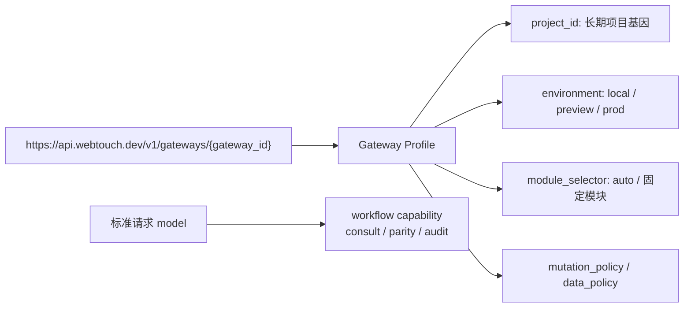
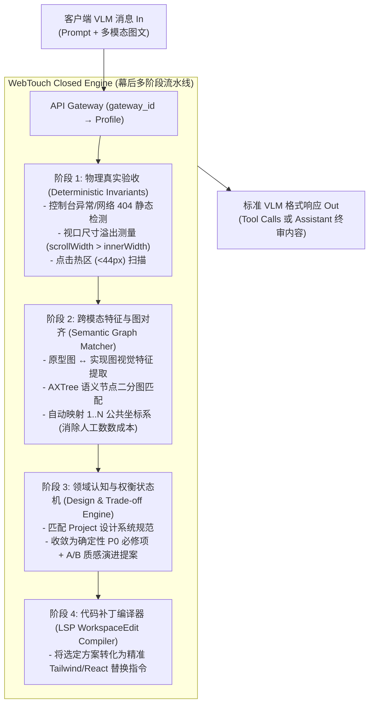
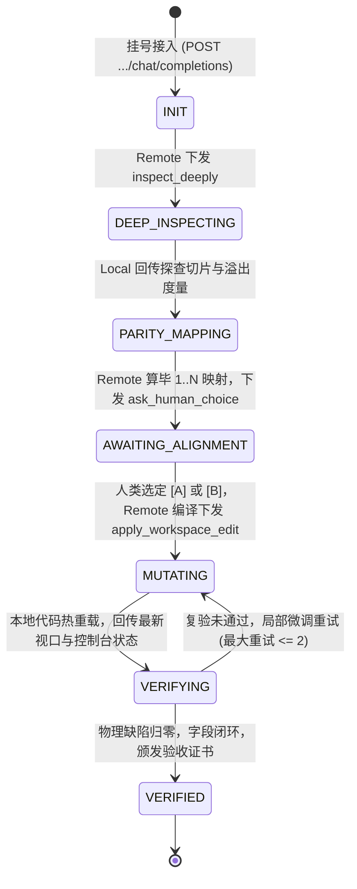

# WebTouch Gateway Profile 与 VLM-Consult 对话式演进架构规范

> **文档定位**：全系统关于 WebTouch API 架构、Gateway Profile、协议兼容层级，以及“表面是 VLM Call，背后是 Pipeline 会诊状态机”交互范式的唯一规范事实源。
> **归属模块**：`agent-tools/webtouch/docs/qa-studio/`
> **生效日期**：2026-09-16；2026-09-17 完成 API 语义收敛修订
> **关联事实源**：
> - 核心纲领：[`WebTouchKeyDesign.md`](../../WebTouchKeyDesign.md)
> - 商业决策与信任架构：[`commercial-strategy-and-trust-architecture-2026-09-14.md`](commercial-strategy-and-trust-architecture-2026-09-14.md)
> - 质检与演进底座白皮书：[`README.md`](README.md)

---

## 目录

1. [核心架构哲学与设计动机](#1-核心架构哲学与设计动机)
2. [Endpoint 架构设计：Gateway Profile 与五类语义分工](#2-endpoint-架构设计gateway-profile-与五类语义分工)
3. [交互范式：VLM-Compatible 表面与幕后 Pipeline 状态机](#3-交互范式vlm-compatible-表面与幕后-pipeline-状态机)
4. [双向会诊机制：Remote 指挥 Local（Tool-Calling 循环）](#4-双向会诊机制remote-指挥-localtool-calling-循环)
5. [Session 状态机与因果证据凭证](#5-session-状态机与因果证据凭证)
6. [实战场景推演：元素核对与质感演进](#6-实战场景推演元素核对与质感演进)
7. [防变形护栏与安全边界](#7-防变形护栏与安全边界)

---

## 1. 核心架构哲学与设计动机

### 1.1 标准协议是兼容表面，不是完整产品能力
WebTouch 优先复用多模态 Messages、Tool-Calling、SSE 与标准错误对象，减少调用方的学习和接入成本；但“协议字段相似”不等于任意客户端都能自动执行本地工具、保持会话或兑现文件修改权限。

因此本规范把兼容性分成两级：
* **协议兼容**：标准 SDK 能完成请求、流式接收与解析 Tool Calls；不承诺客户端自动执行 WebTouch 本地动作。
* **执行兼容**：只有 WebTouch Local Skill / CLI / MCP / 本地桥已经注册工具、执行权限和回传循环时，才允许进入 Remote 指挥 Local 的完整会诊闭环。

Playwright、Lighthouse 等确定性工具继续作为 Evidence Provider；它们与 VLM Call 是互补关系，不以“是否原生融入聊天界面”判断优劣。

### 1.2 现实约束：部分 OpenAI-compatible 客户端只暴露少量配置
一类目标客户端在接入 OpenAI-compatible 服务时，通常只稳定暴露：
1. `OPENAI_BASE_URL` (Base URL)
2. `OPENAI_API_KEY` (API Key)
3. `model`（客户端已有的标准字段）

是否能注入自定义 Header、非标准 Body 字段、回传响应 Header 或执行 Tool Calls，必须按真实客户端逐项验证；不得把 Claude Code、Cursor、Windsurf 等不同协议面的产品概括成同一种客户端。

> **设计结论**：Base URL 只绑定一个预配置的 Gateway Profile；API Key 只表达主体与授权；`model` 只表达稳定的模型/服务能力。三者不能互相冒充，也不承诺仅凭 Base URL 就获得完整本地执行能力。

### 1.3 五类语义必须分离

| 语义 | 规范载体 | 说明 |
|---|---|---|
| 调用主体与授权范围 | API Key / 认证策略 | 回答“谁可以做什么”，不隐式选择目标资源 |
| 项目、环境与执行政策 | `gateway_id` 对应的 Gateway Profile | 回答“在哪个受控上下文中运行” |
| 当前页面/业务模块 | Local 运行时证据或 Profile 的 `module_selector` | 来源于真实 URL、仓库路径和会话现场，不伪装成模型名 |
| 会诊能力 | `model` | 如 `webtouch-consult-v1`、`webtouch-parity-v1`、`webtouch-audit-v1` |
| 会话连续性 | 标准 Messages 或 Responses `previous_response_id`；原生适配器另有 Session 资源 | 不依赖通用客户端自动回传自定义响应 Header |

---

## 2. Endpoint 架构设计：Gateway Profile 与五类语义分工

### 2.1 唯一公开推理入口

WebTouch 的标准 OpenAI-compatible Base URL 定义为：

```text
https://api.webtouch.dev/v1/gateways/{gateway_id}
```

标准 SDK 在该 Base URL 后访问自身支持的端点：
```text
POST https://api.webtouch.dev/v1/gateways/{gateway_id}/chat/completions
POST https://api.webtouch.dev/v1/gateways/{gateway_id}/responses
GET  https://api.webtouch.dev/v1/gateways/{gateway_id}/models
```



### 2.2 Gateway Profile 是配置资源，不是复合字符串协议

`gateway_id` 是稳定、可审计、无需客户端解析的资源标识。服务端 Profile 至少显式保存：

```json
{
  "project_id": "snail-novel",
  "environment": "local",
  "module_selector": "auto",
  "mutation_policy": "require-human-approval",
  "data_policy": "redacted-evidence-only",
  "allowed_models": ["webtouch-consult-v1", "webtouch-parity-v1", "webtouch-audit-v1"]
}
```

`module_selector: "auto"` 时，本地桥从当前 URL、仓库相对路径和实际页面证据解析 `admin` / `storefront` / `checkout`；若必须物理隔离，则创建另一个 Profile，而不是把环境、模块、模式混装进一个 `{scope}` 值。

### 2.3 `model` 只表达能力，不承载项目和环境

公开模型名为稳定产品能力别名：
* `webtouch-consult-v1`：体验诊断、方案权衡与修复建议；
* `webtouch-parity-v1`：元素一一对应核对与证据标绘；
* `webtouch-audit-v1`：确定性物理不变量检查。

底层实际 VLM、提供商、版本与降级路径属于服务端路由实现。禁止使用 `model: "{project}/{module}:{mode}"`，避免污染模型发现、能力声明、计费、缓存、allowlist 与现有 Provider 路由语义。

### 2.4 鉴权、资源选择与冲突规则

* API Key 只识别调用主体及其可访问的 `gateway_id` 集合；Gateway Profile 选择目标上下文。
* Key 与 `gateway_id` 不匹配时返回 `403 gateway_not_authorized`，不得静默改写目标项目。
* 未知 Profile 返回 `404 gateway_not_found`；不支持的能力返回 `400 model_not_allowed_for_gateway`。
* Key 轮换不得改变 Gateway URL；项目名、内部路径与敏感环境信息不作为必须暴露在 URL 中的身份凭证。

### 2.5 原生资源管理面

Gateway/Profile 与 Session 的创建、查询、审计走资源 API，不与 OpenAI-compatible 推理面制造第二套路由语义：

```text
GET  /v1/gateways/{gateway_id}
GET  /v1/sessions/{session_id}
POST /v1/sessions/{session_id}:resume
GET  /v1/sessions/{session_id}/artifacts/{artifact_id}
```

---

## 3. 交互范式：VLM-Compatible 表面与幕后 Pipeline 状态机

WebTouch 的对外契约完全收敛于标准多模态 VLM 请求体：

```json
POST /v1/gateways/gw_snail_local/chat/completions
Content-Type: application/json
Authorization: Bearer wt_live_...

{
  "model": "webtouch-consult-v1",
  "messages": [
    {
      "role": "user",
      "content": [
        { "type": "text", "text": "核对当前页面与设计稿的 31 个字段，修复移动端溢出并升级为 Linear 质感。" },
        { "type": "image_url", "image_url": { "url": "data:image/jpeg;base64,...(离线原型截图)..." } },
        { "type": "image_url", "image_url": { "url": "data:image/jpeg;base64,...(本地真实渲染)..." } },
        { "type": "text", "text": "<!-- 本地脱敏 AXTree 骨架及控制台日志 -->\n<main>...</main>" }
      ]
    }
  ],
  "tools": [
    /* 本地 CLI / Skill 声明暴露的物理执行探针 */
  ]
}
```

### 幕后复合流水线（Compound AI Pipeline）
对外是一个模型，对内是严谨的流水线：



---

## 4. 双向会诊机制：Remote 指挥 Local（Tool-Calling 循环）

WebTouch 的完整形态不是单次无状态问答，而是一次由 Remote 生成建议、Local 掌握物理执行权的有界会诊。

> **协议边界**：标准 Tool-Calling 只定义“模型如何请求工具以及应用如何回传结果”。工具必须由调用方应用执行。未安装 WebTouch Local Skill / CLI / MCP / 本地桥时，服务最多返回可读诊断或 Tool Call，不得宣称已经检查浏览器、修改文件或完成复验。

### 4.1 角色分工
* **Local（Edge 端）**：拥有“手眼器官与物理现实”。连接真实 Chrome、真实 DOM、本地 DevServer 与代码库。
* **Remote（Cloud 端）**：拥有“泰斗级审美与算力”。拥有全球前沿设计基因、高维图匹配算法与权衡协商状态机。

### 4.2 本地开放的标准探针工具集（Local Tools Specification）
在与 Remote 握手时，Local 端通过标准 `tools` 字段向 Remote 声明自身具备的操作能力：

```typescript
// 1. 深度探针：滚动并抓取局部切片与精准物理测量
interface ToolInspectDeeply {
  name: "inspect_deeply";
  description: "在本地真实浏览器中滚动至特定选择器，测量实际排版溢出并抓取高分辨率局部视觉切片。";
  parameters: {
    selector: string;
    viewport?: { width: number; height: number };
    actions?: ("scroll_into_view" | "hover" | "focus")[];
  };
}

// 2. 现场无痕标绘与证据合成：在内存中绘制 1..N 徽标，拼接并排长图并盖戳
interface ToolRenderOverlayAndComposite {
  name: "render_overlay_and_composite";
  description: "在浏览器内存中给目标元素打上编号徽标与彩色描边，合成并排对比图，并计算产物 SHA256 指纹。";
  parameters: {
    badges: Array<{
      node_selector: string;
      badge_text: string;      // "1", "+1", "1'"
      color: "red" | "amber" | "blue" | "gray";
    }>;
    composite_with_baseline: boolean;
  };
}

// 3. 开发者对齐卡片：抛出 A/B 方案供人类单键拍板
interface ToolAskHumanChoice {
  name: "ask_human_choice";
  description: "在 IDE 或终端向开发者渲染结构化权衡卡片，收集人类单键裁决 [A] 或 [B] 以及单行指令。";
  parameters: {
    title: string;
    invariants_p0: string[];
    option_a: { label: string; details: string[] };
    option_b: { label: string; details: string[] };
  };
}

// 4. 微创代码写入：由 Local Agent 操刀修改源码并等待热重载
interface ToolApplyWorkspaceEdit {
  name: "apply_workspace_edit";
  description: "将代码修改指令精准写入本地源码文件，等待 HMR 完成后重新截取视口快照。";
  parameters: {
    edits: Array<{
      file_path: string;
      target_snippet: string;
      replacement_snippet: string;
      rationale: string;
    }>;
  };
}
```

---

## 5. Session 状态机与因果证据凭证

为了保证会诊不会陷入“无限咨询黑洞”，云端将整个会话绑定在一个有界状态机（Bounded State Machine）中推进：



### 5.1 Session ID 的流转机制
* **Chat Completions 兼容面**：由客户端回传完整 `messages`；不得依赖客户端自动回传自定义响应 Header。
* **Responses 兼容面**：使用标准 `previous_response_id` 续接；客户端不支持时降级为显式输入历史。
* **WebTouch 原生适配器**：可创建 `sess_...` 资源，并通过 `GET /v1/sessions/{session_id}` 查询、`POST /v1/sessions/{session_id}:resume` 恢复；该能力属于本地桥/CLI，而不是“任意 OpenAI-compatible 客户端零改造”的承诺。
* `X-WebTouch-Session` 可作为可观测性响应头，但不是协议唯一状态载体，也不假设通用客户端会自动回传。

### 5.2 交付产物：不可篡改的验收证书（Acceptance Certificate）
Session 进入 `VERIFIED` 状态时，系统生成不可否认的交付 JSON 与并排证据图，载明：
1. `gateway_id`、`project_id`、`environment`、实际解析的 `module` 与 `model/workflow`；
2. 原型渲染快照与实现终态快照的 **双重 SHA256 数字指纹**；
3. 31 个字段的最终对应状态表（MATCH 18 / MISSING 0 / EXTRA 0 / RELOCATED 1）；
4. 开发者亲笔拍板选定的设计方案版本。

---

## 6. 实战场景推演：元素核对与质感演进

以一个经典实战为例：开发者使用 Cursor 编写了小说内容详情页 `BookDetail.tsx`。

### 第 1 轮：现场初诊
* **开发者**：在 IDE 内触发 `/webtouch improve`。
* **Local**：静默调用本地 Chrome，截取当前页面与原型快照，调用：
  `POST .../gateways/gw_snail_local/chat/completions`
* **Remote 网关**：由 `gw_snail_local` 的 Gateway Profile 载入项目字段定义库、环境政策与设计预设；当前模块由 Local 现场证据解析。
* **Remote Pipeline**：运行阶段 1，发现价格配置区文本被截断，且 390px 视口下页面横向宽出 42.5px。
* **Remote 响应**：下发 `tool_calls: [inspect_deeply({ selector: ".pricing-matrix", viewport: { width: 390, height: 844 } })]`。

### 第 2 轮：深度切片与图映射
* **Local**：执行本地滚动与度量，回传真实溢出切片。
* **Remote Pipeline**：运行阶段 2，将原型与实现进行实体图匹配，自动推导出 **31 个标准字段位**：
  * 发现缺失 12 处关键元数据（频道、形态、状态标签等）；
  * 发现多出 22 处快捷操作按钮；
  * 发现封面图由独立头部下移到了卡片内（换落点）。
* **Remote 响应**：依次下发 `render_overlay_and_composite` 与 `ask_human_choice` Tool Calls，带上 31 个字段的编号图层数据与方案卡片。

### 第 3 轮：现场标绘与人类决策
* **Local**：在本地浏览器内存中注入 1..N 徽标与红/琥珀/蓝描边，本地合成高清并排对比长图；
* **Local**：在 IDE 聊天栏向人类开发者弹出结构化卡片：
  > 🔍 **WebTouch 会诊就绪：发现 12 处原型缺失与 22 处冗余按钮**
  > ⚠️ 移动端价格表格撑破视口（+42.5px 溢出）
  > [A] **严谨复刻原型（推荐）**：补齐 12 处缺失字段占位，剔除 22 处冗余按钮，采用 Linear 暗调微边框。
  > [B] **保留现有丰富操作**：将多余按钮收纳进下拉折叠菜单，优化间距防止溢出。
  > *(请在聊天框回复 [A] 或 [B])*
* **开发者**：回复 `"选 A，保留绿色的 accent 高亮"`。
* **Local**：将用户的拍板结果作为 `tool_result` 喂回给 Remote。

### 第 4 轮：动刀编译与复验闭环
* **Remote Pipeline**：运行阶段 4，针对 React + Tailwind 编译出精准的原子类与结构修改指令（`apply_workspace_edit`）。
* **Local**：将补丁写入 `BookDetail.tsx`，Vite 完成热重载。
* **Local**：二次抓取重载后的页面与指标，作为 `tool_result` 回传。
* **Remote**：终审查验物理溢出归零、MISS 归零、控制台干净。
* **Remote 响应**：输出 `finish_reason: "stop"`，交付验收卡片，Session 状态跃迁至 `VERIFIED`！

---

## 7. 防变形护栏与安全边界

为确保该架构在长期演进中保持纯粹，设立以下系统铁律：

1. **绝对防源码出域（Zero Code Leakage）**：
   * 任何发往 Remote 的多模态 Payload，**严禁包含项目 `.tsx` / `.vue` 源码全文、Git 敏感信息或本地敏感数据**；
   * 发往云端的仅限脱敏后的轻量 AXTree 骨架、渲染切片与客观报错。
2. **禁止代客主观裁决（Strict Human-in-the-loop）**：
   * 缺漏的字段补不补、冗余的代码撤不撤，必须通过 `ask_human_choice` 交给人类确认，严禁 Agent 自作主张破坏业务意图。
   * `apply_workspace_edit` 只能由 Local 在用户授权与本地权限闸内执行；Remote Tool Call 本身不构成写入授权。
3. **不可伪造的指纹证据（Verifiable Cryptographic Proof）**：
   * 所有对比验收产物，必须由本地直接计算两端渲染与 DOM 的真实 `SHA256` 并固化在报告页脚，杜绝“拿历史旧图冒充当前成功”的虚假交付。
4. **免费层与商业化大脑的物理硬隔离**：
   * 本地 CLI 运行的物理不变量检查（Lighthouse 级别客观检查）完全免费、离线可用；
   * 云端 Gateway Profile 承载的语义图对齐、A/B 权衡提纯与 Tailwind 精准代码编译作为商业化 Pro 服务，按 Session 价值计费。
