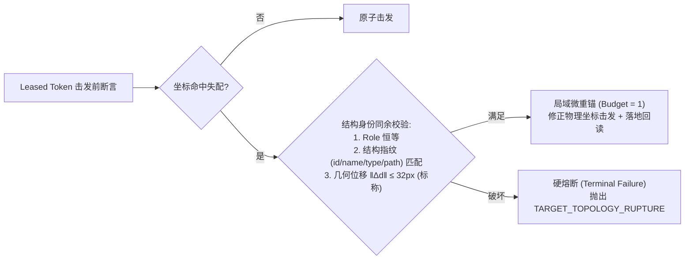
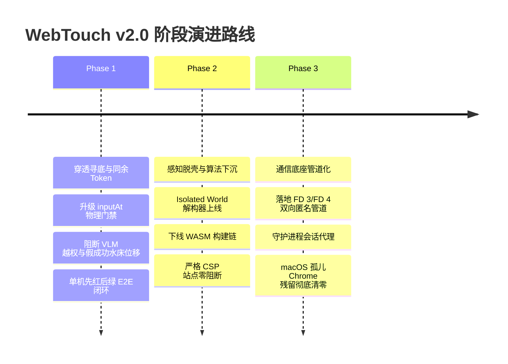

# WebTouch v2.0 架构演进与内核拓扑技术规范 (RFC)

> **文档属性**：Living Spec · 核心架构与决策事实源  
> **状态**：`APPROVED(目标态)`（v2.0 目标态蓝图；对应 Phase 落地前现役以 `spec/algorithm-kernel.md` 为准）  
> **生效时间**：2026-09-25  
> **适用领域**：02-Organ（执行器官）与 03-Engine-Alg（决策内核）  
> **前置规范**：[`WebTouchKeyDesign.md`](../WebTouchKeyDesign.md)、[`../spec/algorithm-kernel.md`](../spec/algorithm-kernel.md)、[`system-map-2026-09-23.md`](system-map-2026-09-23.md)

---

## 效力层级与取代时机（Precedence & Migration Trigger）

1. **目标态定位**：本 RFC 是 WebTouch 迈向 v2.0 的全局架构演进蓝图与终局契约；
2. **现役权威声明**：在下文所述 Phase 1 / Phase 2 / Phase 3 的代码与测试正式合入前，系统的生产执行与验收判决**一律以现役规范 [`../spec/algorithm-kernel.md`](../spec/algorithm-kernel.md)（§5.0.2~§5.0.9，含 §5.0.8 条款 3 `csp_wasm_blocked` 显式化）为唯一法律准绳**；
3. **分阶段取代与版本闭环**：
   - Phase 1 落地时：改写 `spec/algorithm-kernel.md` §5.0.9（引入结构身份同余断言与 Leased Token），追加 §11 版本历史；
   - Phase 2 落地时：下线页内 WASM 探针，将 §5.0.8 改写为 Isolated World + AX 局部切片契约（废弃 `csp_wasm_blocked` 代号），追加 §11 版本历史；
   - Phase 3 落地时：重构通信底座为双向匿名管道，更新 02-Organ 物理连接规范；
   - 严禁代码已改而规范滞后，杜绝“死法条”与“时态漂移”。

---

## 一、 背景与系统性张力根因（Problem Statement）

在 WebTouch v1.5 的工业级落地评测（尤其是在 Tranco 头部 12 站 real-site 端到端验证与 P0/P1/P2 风险排查）过程中，系统遭遇了深水区的七大核心系统性张力：

1. **假成功的出口位移（Waterbed Effect）**：单层安全门禁（如 span 校验）把非法写入从“规则层”挤压至自由度更高的“VLM 坐标兜底层”（如 GitHub 邮箱框被越权写入但报告仍计成功）。
2. **敏感画像与合法词法的碰撞**：词法黑名单无法区隔 `user/phone` 与合法词汇（如 `microphone`, `user-search`），导致不误伤与不越权激烈对撞。
3. **感知降级无安全默认值**：严格 CSP 站点（如 GitHub 禁 `wasm-unsafe-eval`）使页内 WASM 探针不可实例化；快速失败导致头部站掉覆盖，静默放宽则导致弱证据不可信。
4. **数据载体污染的“打地鼠”循环**：滤除 `<style>` 后污染改走隐藏 `textarea` 的 JSON 水合块；黑名单枚举注定滞后。
5. **宿主运行态的隐式环境陷阱**：非交互式守护进程重启静默丢失环境变量导致 VLM 兜底失效；真机验收高成本与配额保护的死结。
6. **外部负载与时钟抖动**：宿主遗留僵尸 Chrome 进程导致 Load 飙升至 30~45，导致评测断言因超时假死失去置信度。
7. **单仓多线协作高摩擦**：单工作树多分支并行易夹带改动，高强度 TDD 案卷取证使得单次缺陷修复成本陡增。

为了从第一性原理彻底铲除上述系统张力，本 RFC 正式确立 **WebTouch v2.0 物理内核拓扑与感知执行规范**。

---

## 二、 核心架构拓扑图景

```mermaid
flowchart TD
    subgraph Multi_Session_Topology["双模传输分流与多会话调度拓扑"]
        direction TB
        CLI1["外部 CLI (uws run A)"] -->|UDS / gRPC| Daemon["常驻调度引擎 (uws daemon)"]
        CLI2["外部 CLI (uws run B)"] -->|UDS / gRPC| Daemon
        ExtTool["外部调试者 / 只读取证"] -->|HTTP /json/list 代理| Daemon
        AttachCLI["用户自建窗 (--attach)"] -->|WebSocket 降级通道| AttachedChrome["外部非托管 Chrome (9222)"]

        subgraph Daemon_Core["Daemon 进程内多路复用与诊断代理"]
            Router["CDP Session & Target Router"]
            DiagServer["只读诊断代理 (兼容 /json/list)"]
            Multiplexer["Target ID 多路分发器"]
        end

        Daemon --> Router --> Multiplexer
        Multiplexer -->|FD 3 写 / FD 4 读 (独占管道)| ManagedChrome["受管 Chrome 实例 (Managed)"]
        
        ManagedChrome --> Tab1["Tab 1 (Session A)"]
        ManagedChrome --> Tab2["Tab 2 (Session B)"]
    end
```

### 双模分流契约 (Managed Master vs. Attached Transport Fallback)
1. **受管实例（Managed Chrome，绝对主干）**：由 `uws daemon` 独占拉起并持有双向匿名管道（FD 3/FD 4）。Daemon 内部维护基于 `sessionId` 的多路复用路由，外部 CLI 仅作为无状态轻量客户端通过本地 Unix Domain Socket 交互。该拓扑杜绝多进程竞争脑裂，并保障 macOS 孤儿进程 100% 物理级联自毁；
   - **取证旁路保障**：为了防止剥离 9222 端口导致 `curl /json/list` 只读取证通道失效，Daemon **必须内置暴露本地只读诊断端点**（通过本地 HTTP 或 UDS 协议提供等价的 `/json/list` 与目标快照查询），确保现场取证门禁绝对可用。
2. **外部附着实例（Unmanaged Chrome，调试旁路）**：仅在显式传入 `--attach <host:port>` 参数时触发，降级为经典 WebSocket 通信通道，系统不接管进程生命周期，继续无缝覆盖用户自己打开的调试窗口。

---

## 三、 三大底层物理设计推演

### 推演 1：异步无障碍投影与局部求值（Lazy AOM Incremental Projection）
* **物理事实**：Blink 内核无障碍对象模型 `AXObjectCache` 默认处于休眠或惰性构建态。在 JS 渲染主线程中同步全量遍历计算属性在复杂页面上将触发整树排版重算（Full Style & Layout Recalculation），造成事件循环不可预测的阻塞（设计假设极端峰值 $\Delta t \ge 50\text{ms}$）。
* **架构解法（标称目标）**：
  - 严禁在页内 Isolated World 中以 JS 递归遍历 DOM 逆向模拟 AOM；
  - 宿主在建立会话时下发 `Accessibility.enable`，由 Blink C++ 后台线程异步维护 AX 树；
  - 需对齐意图时，仅调用 `Accessibility.getPartialAXTree(nodeId, fetchRelatives=false)` 针对视口焦点候选根节点执行局部切片，将主线程渲染阻塞压制至接近 0ms，彻底天然剥离非视觉数据载体。

### 推演 2：穿透寻底与组合路径不变性（Composed Path Piercing Invariance）
* **物理事实与技术边界**：
  - 封闭 Shadow Root（`mode: "closed"`）在页内任何 Execution World（包含 Isolated World）下 `shadowRoot` 均恒为 `null`，且 `composedPath()` 是 `Event` 实例的方法、在 `Element` 上不存在；页内纯 JS 无法突破封闭 Shadow DOM 的黑盒封装；
  - 现代 Web 广泛使用组件封装与全局透明手势遮罩层（`opacity=0` / `aria-hidden="true"` / `pointer-events:none`）。标准 `document.elementFromPoint(x, y)` 仅返回最外层宿主节点或顶层透明层，抹杀真实可编辑受体。
* **架构解法（双层分工）**：
  - **受体画像主干走 CDP AX 局部切片**：Blink 内核 Accessibility 树在 C++ 层面天然穿透 closed shadow DOM，且天然排除非交互式与隐藏数据载体，作为候选受体身份识别的唯一主干；
  - **页内 JS 仅作几何层叠判定**：通过 `document.elementsFromPoint(x, y)` 栈与 `getRootNode({composed: true})` 祖先回溯，专门负责识别并穿透顶层无输入监听的透明手势代理层（`opacity=0` ∨ `aria-hidden="true"`），确保物理击发点直达底层真实受体。

### 推演 3：管道破裂无条件级联自毁（Pipe-Break Cascade Fate-Sharing）
* **物理事实**：Darwin (macOS) 内核缺少 Linux 特有的 `PR_SET_PDEATHSIG`，当父进程异常退出时，Chromium 渲染与 GPU 子进程会被 `launchd (PID 1)` 接管成为常驻僵尸进程，持续争抢 CPU 时钟与显存。
* **架构解法**：
  - 在受管模式下全面重构为 **FD 3 (Write) / FD 4 (Read) 原生双向匿名管道通信**（通过 Chromium `--remote-debugging-pipe` 参数）；
  - 启动参数彻底剔除 `--remote-debugging-port`，消除端口碰撞与宿主端口扫描敞口（由 Daemon 诊断端点承接取证）；
  - 当 Go 宿主进程终止（SIGKILL, SIGSEGV, Panic）时，内核硬件契约保证写端关闭，Chromium 在管道读端捕获 EOF 并在看门狗线程中无条件级联触发 `exit(0)`，配合启动前 `SingletonLock` 原子清理，实现 100% 物理命运绑定。

---

## 四、 两大核心决策裁决

### 裁决 1：Leased Token 断言失败后的恢复拓扑 —— 结构身份同余微重锚



1. **同余判定（摒弃脆弱的 Name 恒等，转向结构身份）**：
   $$\text{Homology}(e, e') \iff \text{Role}(e) \equiv \text{Role}(e') \land \text{Fingerprint}(e) \equiv \text{Fingerprint}(e')$$
   - $\text{Fingerprint}$ 锁定表单要素稳定特征（`id`, `name`, `type`, 表单归属）与 DOM 拓扑相对路径；
   - 解决因水合动态修改 placeholder/aria-label（Name 突变）导致的假拒绝；Accessible Name 仅作弱加权参考，不作一票否决项。
2. **空间局域截断（设计假设与标称阈值）**：
   $$\Vert\text{Center}(e) - \text{Center}(e')\Vert_2 \le R_{\text{tolerance}} \quad (\text{标称目标 } R_{\text{tolerance}} = 32\text{px})$$
   - 容忍异步水合引发的良性微位移；超出阈值直接定性为 `TARGET_TOPOLOGY_RUPTURE` 终局硬失败；
   - **Phase 1 前置取证项**：在实施前必须对典型动态站点进行真机采样，实际统计位移分布以标定最终阈值。
3. **单调阻尼与落地回读（强制闭环）**：
   $$\text{Budget}_{\text{reanchor}} = 1 \quad (\text{单步全局硬上限})$$
   - 严禁将控制权交回 VLM 自由发挥（杜绝水床效应）；
   - **重锚击发后必须无条件执行既有 `inputLanded` 落地回读**，回读不通过依然硬判 `FAILED(vlm_landing_unverified)`，绝无假成功出口。

### 裁决 2：WASM 探针存废与分层迁移 —— 单向资产下沉（Single-Track Host Downlink）

1. **彻底否决双轨混合态**：严禁在“无 CSP 用 WASM、有 CSP 用 Isolated World”之间摇摆，避免引入不可消除的跨平台浮点与文本归一化语义漂移（Semantic Drift）；
2. **单向脱壳与算子下沉（标称设计目标）**：
   - **页内极轻量化**：通过 `Page.createIsolatedWorld` 挂载执行耗时标称 $< 2\text{ms}$ 的纯 JS 扁平属性解构器，仅导出纯净视口候选元数据（标称单次 IPC Payload $< 5\text{KB}$）；
   - **Go 原生算子承接**：将原 `probe_wasm` 中的几何加权、`ownText` 提取与排序算子用 Go 原生重构（标称纯逻辑耗时 $< 0.5\text{ms}$，内存 $< 64\text{KB}$），**彻底规避 CGO 跨平台编译复杂度**；
   - **下线构建链**：移除 `build/probe_wasm_*`，彻底解耦目标站点任何 CSP 安全策略。

---

## 五、 四大实施切片与代码落点映射

| 手术切片 | 目标职责 | 关键代码落点 | 核心变动与收益 |
| :--- | :--- | :--- | :--- |
| **手术 1：宿主生命周期** | FD 3/4 管道绑定 + Daemon 诊断代理 | `coordinator/attach.py`<br>`pkg/browser/cdp_session.go`<br>`apps/gateway/` | 剥离调试端口；通过 `exec.Cmd.ExtraFiles` 映射管道；内置 `/json/list` 诊断代理；监听 EOF 级联自愈。消除僵尸进程，保留取证能力。 |
| **手术 2：感知脱壳下沉** | AX 切片 + Isolated World 解构 + Go 算子 | `pkg/browser/isolated_world.go` (新)<br>`pkg/browser/probe.go`<br>`pkg/engine/candidate_ranker.go` (新) | 剥离页内 WASM 运行时；完全规避 CSP `script-src` 拦截；GitHub/Twitter 等探针阻断率归零。 |
| **手术 3：穿透寻底** | Composed 祖先回溯 + 顶层透明遮罩剔除 | `pkg/browser/input_gate.go`<br>`pkg/browser/cdp_session.go` | AX 负责穿透 closed shadow DOM；页内 JS 负责识别并剔除顶层透明手势遮罩层。 |
| **手术 4：Leased Token 与同余微重锚** | 结构身份断言 + 32px 局部重锚 + 强制回读 | `pkg/browser/cdp_session.go::inputAt`<br>`pkg/engine/vlm_fallback.go` | 绑定 $\le 1500\text{ms}$ 租约与 32px 局部截断；单步 Budget=1；回读不过即熔断。 |

---

## 六、 演进路线图与分阶段准入门禁



### 1. Phase 1 准入门禁（门禁与寻底闭环）
- **前置取证**：完成动态站点真机采样，标定位移与耗时分布；
- **自愈率**：动态微位移场景下单步自愈率 $\ge 95\%$，且无次生漂移越权；
- **越权拦截率**：高危意图（注册、邮箱、密码）派发至非对应受体时，拦截率维持 100%，无假成功位移。

### 2. Phase 2 准入门禁（脱壳与 CSP 免疫）
- **CSP 阻断归零**：严格 CSP 站点（如 GitHub 下发 `script-src` 禁 `unsafe-eval`）探针执行成功率 100%，`csp_wasm_blocked` 阻断信号彻底归零；
- **构建脱壳**：移除 WASM 构建工具链与中间体积，`ExportPageTree` 延迟达到标称指标。

### 3. Phase 3 准入门禁（通信底座与生命周期）
- **僵尸残留归零**：管道化模式合入；Daemon 异常退出或强杀压测中，**本线派生的 Chrome 僵尸进程残留计数严格归 0**；
- **取证能力保真**：Daemon 诊断代理端点 `/json/list` 兼容性达 100%；
- **时序确定性**：单步因本线进程抢占导致的超时率降至 0。

---

## 七、 平台边界与已知不变量约束

1. **操作系统支持边界**：
   - FD 3/FD 4 原生管道模式在 macOS (Darwin) 与 Linux 上作为第一公民全面强制执行；
   - Windows 平台的句柄继承与命名管道支持列为后续独立扩展项（当前标记为 `PARKED`）。
2. **大尺度页面位移处置**：
   - 若在租约窗口期内用户或脚本触发了大范围滚动或视口跳转（导致 $\|\Delta d\|_2 > 32\text{px}$），系统断然拒绝就地重锚，强制抛出 `TARGET_TOPOLOGY_RUPTURE`，由上层 Agent 重新观察并重采样。
