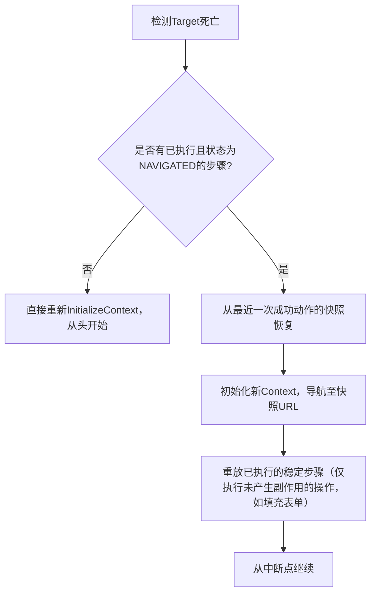

# 文档一：协调器智能规划模块设计（Coordinator Design Specification）

**版本**：V1.0  
**状态**：冻结，可编码  
**依赖**：WebTouch内核V1.4（gRPC接口已锁定）  
**生效日期**：2026-08-19

> ⚠️ **2026-09-02 分层定稿后标记（历史协调层）**：本文件将 Python 协调器描述为
> 「任务编排大脑」。按分层定稿（`docs/evidence/archive/web-touch-architecture-2026-09-02.md` 与 `docs/README.md`），
> 任务调度编排属**外层应用 / 多 Agent 编排**，不在 WebTouch 核心；协调器现为
> 「调用 WebTouch 的外层编排 + 历史 SDK」，其 planner/executor/reflector 与核心的
> 分层边界以定稿为准。本文件保留为历史设计参考。

---

## 1. 设计目标与边界

### 1.1 定位
协调器（Coordinator）是WebTouch系统的**任务编排大脑**。它接收用户/上层应用的**高层级目标**（如“登录Gmail并下载最新一封邮件的附件”），将其分解为**原子动作序列**，通过WebTouch引擎的`ExecuteAction`接口驱动浏览器执行，并根据执行反馈（`ActionResult`）动态调整计划，直至宏观任务完成或失败。

### 1.2 核心约束（阿姆达尔定律遵循）
- **轻量无状态**：协调器本身不运行浏览器或AXTree匹配，所有浏览器交互由WebTouch引擎代理。协调器仅维护**任务级状态**（内存/Redis）。
- **确定性优先**：在可能的情况下优先使用**任务模板**驱动，LLM仅用于**模板匹配失败时的降级补全**。目标：70%以上常规任务可由纯模板完成，LLM规划调用率<30%。
- **隔离性**：每个任务实例（`task_id`）拥有完全独立的记忆空间和目标上下文，互不干扰。

### 1.3 任务类型定义
| 类型 | 定义 | 示例 |
|------|------|------|
| **单步任务** | 仅需1次原子动作 | “点击确认按钮” |
| **线性多步任务** | 固定顺序的动作序列，无分支 | “登录：输入用户名 → 输入密码 → 点击登录” |
| **条件分支任务** | 动作路径依赖页面状态或变量 | “如果出现验证码则调用OCR，否则直接提交” |
| **循环/迭代任务** | 重复执行一组动作直到满足退出条件 | “遍历列表页，点击每个‘详情’并抓取价格，直到翻页结束” |
| **长周期任务** | 跨站点、多分支、含反思重试的复杂工作流 | “聚合3个竞品网站的价格，输出最低价报表” |

---

## 2. 系统架构与模块划分

```
┌─────────────────────────────────────────────────────────────────────────────┐
│                        协调器（Coordinator）                                │
│                                                                             │
│  ┌───────────────┐    ┌─────────────────┐    ┌──────────────────────────┐  │
│  │ 任务解析器     │───▶│  规划器          │───▶│   调度执行器              │  │
│  │ (Parser)      │    │  (Planner)      │    │   (Executor)              │  │
│  └───────────────┘    └─────────────────┘    └──────────────────────────┘  │
│         │                     │                         │                  │
│         ▼                     ▼                         ▼                  │
│  ┌───────────────┐    ┌─────────────────┐    ┌──────────────────────────┐  │
│  │ 模板引擎       │    │  记忆/上下文模块 │    │   重试与反思器            │  │
│  │ (Template)    │    │  (Memory)       │    │   (Reflector)             │  │
│  └───────────────┘    └─────────────────┘    └──────────────────────────┘  │
│                                                    │                       │
│                                                    ▼                       │
│                              ┌──────────────────────────────────────────┐  │
│                              │   WebTouch gRPC客户端（含多Target池管理）     │  │
│                              └──────────────────────────────────────────┘  │
└─────────────────────────────────────────────────────────────────────────────┘
```

| 模块 | 职责 |
|------|------|
| **解析器（Parser）** | 将自然语言或结构化输入（YAML/JSON）转为内部任务图（DAG） |
| **模板引擎（Template Engine）** | 加载、匹配、实例化任务模板（含变量插值`{{variable}}`） |
| **规划器（Planner）** | 对无模板匹配的任务，调用LLM生成动作序列；或对模板进行动态补全 |
| **记忆模块（Memory）** | 维护跨步骤的上下文变量（已填值、已访问页面、提取的数据） |
| **调度执行器（Executor）** | 驱动动作执行、管理并发Target、处理状态机流转 |
| **重试与反思器（Reflector）** | 分析失败原因，执行局部重试、全局重规划或宣告失败 |

---

## 3. 数据模型（协调器侧）

### 3.1 任务定义 `TaskDefinition`

```python
@dataclass
class TaskDefinition:
    task_id: str                     # UUIDv7
    name: str                        # 任务名称
    mode: str                        # "single" | "linear" | "conditional" | "loop" | "long"
    template_ref: Optional[str]      # 引用的模板ID（若有）
    plan: List[ActionNode]           # 初始计划（由模板或LLM生成）
    context: TaskContext             # 运行时上下文
    max_steps: int = 50              # 最大动作步数（防死循环）
    status: str = "PENDING"          # PENDING | RUNNING | PAUSED | SUCCEEDED | FAILED
```

### 3.2 动作节点 `ActionNode`

```python
@dataclass
class ActionNode:
    step_id: str                     # 步骤唯一ID
    action_type: str                 # click | input | select | focus | hover | scroll | wait | extract
    target_semantic: str             # 语义标签，如 "username_input"
    value: Optional[str] = None      # 输入值或等待条件
    condition: Optional[str] = None  # 条件表达式（用于分支）
    loop: Optional[Dict[str, str]] = None # 循环配置
    timeout_ms: int = 1500           # 动作执行+验证总超时
    retry_count: int = 0
    max_retries: int = 2
    on_failure: str = "abort"        # abort | retry | skip | replan
    depend_on: List[str] = field(default_factory=list)  # 依赖的前置step_id
```

### 3.3 运行时上下文 `TaskContext`（跨步骤记忆）

```python
@dataclass
class TaskContext:
    variables: Dict[str, Any]        # 全局变量池 { "username": "alice", "extracted_prices": [...] }
    history: List[ActionResult]      # 已执行步骤的结果
    visited_urls: Set[str]           # 已访问URL集合（去重）
    current_target_id: Optional[str] # WebTouch引擎当前Target ID
    current_state: str = "IDLE"      # IDLE | WAITING_NAV | WAITING_STABLE | EXECUTING
    navigation_counter: int = 0      # 同任务内导航次数
```

### 3.4 任务模板 `TaskTemplate`（可导出/导入）

```yaml
# 示例：通用登录模板
template_id: "login_generic_v2"
name: "通用登录流程"
parameters:                     # 对外暴露的变量
  - username
  - password
  - login_button_text

steps:
  - step_id: step_1
    action_type: "input"
    target_semantic: "username_input"
    value: "{{ username }}"
    depend_on: []
    
  - step_id: step_2
    action_type: "input"
    target_semantic: "password_input"
    value: "{{ password }}"
    depend_on: ["step_1"]
    
  - step_id: step_3
    action_type: "click"
    target_semantic: "{{ login_button_text }}"
    depend_on: ["step_2"]
    on_failure: "replan"          # 若点击失败，触发重新规划
    
  - step_id: step_4
    action_type: "wait"
    target_semantic: "NAVIGATED"   # 等待导航完成
    value: "5000"                  # 最大等待ms
    depend_on: ["step_3"]
```

---

## 4. 规划器（Planner）设计

### 4.1 规划策略分层

| 层级 | 触发条件 | 实现方式 | 延迟 |
|------|----------|----------|------|
| **L1 精确模板匹配** | 输入目标匹配`template_id`及参数 | 直接加载YAML模板，变量插值 | <1ms |
| **L2 模糊模板匹配** | 输入自然语言与现有模板描述Embedding相似度>0.85 | 使用MiniLM或BGE向量检索，取Top1模板实例化 | ~50ms |
| **L3 LLM辅助补全** | L1/L2均未命中，但部分步骤可复用模板片段 | 将目标+可复用片段上下文发给LLM，补全缺失步骤 | ~1-3s |
| **L4 完全LLM规划** | 冷启动或全新任务类型 | 将`System Prompt`+当前页面AXTree精简文本（来自WebTouch）发给LLM，生成完整计划 | ~3-5s（接受降级） |

### 4.2 LLM规划Prompt工程（精简版）

```text
[System]
你是浏览器任务规划专家。将用户目标分解为原子动作序列。
输出严格遵循JSON Schema，仅包含动作列表，不输出解释。

[JSON Schema]
{
  "steps": [
    {
      "action_type": "input|click|select|wait|extract",
      "target_semantic": "简短描述目标节点语义",
      "value": "仅对input/select有效，其他留空",
      "depends_on": ["前置步骤ID"]
    }
  ]
}

[当前页面摘要]
<AXTree精简文本>（由WebTouch引擎提供，仅包含可交互节点及语义标签）

[用户目标]
{user_query}

[可用模板片段]
{matched_template_snippets_json}  // 如果有部分匹配
```

### 4.3 规划验证与修复
- **环检测**：新生成的计划不允许存在循环依赖（如 step_3 依赖 step_2，step_2 又依赖 step_3）。
- **死链检测**：所有依赖必须存在于计划中。
- **无效动作过滤**：若`target_semantic`为空或纯占位符，自动丢弃或标记需人工介入。

---

## 5. 状态机与执行调度（Executor）

### 5.1 任务级状态机（每个Task）
```
         ┌──────────┐
         │ PENDING  │
         └────┬─────┘
              ▼
         ┌──────────┐
      ┌─▶│ RUNNING  │◀─┐
      │  └────┬─────┘  │
      │       ▼        │
      │  ┌──────────┐  │ (重试/反思)
      │  │ WAITING  │──┘
      │  │(响应/导航)│
      │  └────┬─────┘
      │       ▼
      │  ┌──────────┐
      │  │ 动作执行 │
      │  └────┬─────┘
      │       ▼
      │  判断结果──┬──成功──▶ 下一动作
      │          │
      │          └──失败──▶ Reflector
      │                     │
      │          ┌──────────┘
      │          ▼
      │  ┌─────────────┐
      │  │ 重试/重规划  │
      │  └─────────────┘
      ▼
 ┌──────────┐
 │ SUCCEEDED│ 或  │ FAILED │
 └──────────┘
```

### 5.2 并发与Target配额管理

- **单任务配额**：每个任务默认最多同时持有**1个**浏览器Target（串行执行）。
- **多Target任务（高级）**：若`TaskDefinition`中明确声明`parallel_targets > 1`，协调器可向WebTouch申请额外Target（受`N_targets = CPU_Cores × 1.5`约束）。
  - 多Target场景典型：同时监控多个产品页面价格。
- **排队策略**：当请求Target超过配额时，新任务进入FIFO等待队列，超时（30s）后返回`RESOURCE_EXHAUSTED`给上层。

### 5.3 动作执行循环（主循环伪代码）

```python
async def run(task: TaskDefinition):
    task.status = "RUNNING"
    # 1. 初始化上下文
    init_resp = await uws_client.InitializeContext(InitContextRequest(
        proxy=...,
        viewport=...,
        cookies=task.context.cookies,
        timezone=...
    ))
    target_id = init_resp.target_id
    
    pending_steps = task.plan[:]
    execution_history = []
    
    while pending_steps and task.status == "RUNNING":
        # 2. 按依赖拓扑排序，取所有依赖已满足的步骤
        ready_steps = get_ready_steps(pending_steps, execution_history)
        if not ready_steps:
            raise Exception("Deadlock detected in plan")
        
        step = ready_steps[0]  # 简单模式单步执行
        
        # 3. 执行动作
        request = build_action_request(step, task.context)
        try:
            response = await uws_client.ExecuteAction(request, timeout=step.timeout_ms)
            task.context.history.append(response)
            
            # 4. 状态机处理
            if response.context_state == "NAVIGATING":
                # 引擎层正在等待网络静息，协调器等待后续状态更新（由流式接口或轮询处理）
                await wait_for_stable(target_id, timeout=5000)
            elif response.context_state in ["NAVIGATED", "NEW_WINDOW_OPENED"]:
                task.context.navigation_counter += 1
                # 若为新窗口，需更新target_id
                if response.context_state == "NEW_WINDOW_OPENED":
                    target_id = await attach_new_target(target_id)
                    task.context.current_target_id = target_id
                    
            # 5. 记录成功，标记步骤完成
            mark_step_done(step, response)
            
        except Exception as e:
            # 6. 失败处理：转交Reflector
            reflect_result = await reflector.handle_failure(step, e, task)
            if reflect_result.action == "retry":
                step.retry_count += 1
                if step.retry_count <= step.max_retries:
                    continue  # 重试当前步骤
                else:
                    # 超过重试次数，标记失败
                    task.status = "FAILED"
                    break
            elif reflect_result.action == "replan":
                # 重规划后续步骤
                new_plan = await planner.replan(task, reflect_result.context)
                pending_steps = merge_plan(pending_steps, new_plan, step.step_id)
                mark_step_done(step, reflect_result.fallback_response)  # 标记当前失败但采用重规划
            elif reflect_result.action == "skip":
                mark_step_skipped(step)
            else:  # abort
                task.status = "FAILED"
                break
    
    # 7. 判断最终状态
    if task.status == "RUNNING" and not pending_steps:
        task.status = "SUCCEEDED"
    return task
```

---

## 6. 重试与反思器（Reflector）

### 6.1 失败根因分类（基于WebTouch返回码）

| WebTouch错误码 | 根因分类 | 推荐策略 |
|-----------|----------|----------|
| `NOT_FOUND` | 目标元素不存在（语义漂移/页面改版） | **重规划**（调用LLM重新定位或查找替代元素） |
| `DEADLINE_EXCEEDED` | 超时（网络慢/CPU繁忙） | **退避重试**（Fibonacci: 1s, 2s, 3s）最多2次 |
| `ABORTED` | 元素瞬间被遮罩/移除（动画/异步渲染） | **立即重试**（等待200ms后重试，最多3次） |
| `FAILED_PRECONDITION` | Target崩溃或状态脏 | **全局重规划**（重新初始化Target，从头开始当前阶段） |
| `RESOURCE_EXHAUSTED` | LLM配额耗尽/Target池满 | **降级**：若任务含兜底逻辑（如纯规则备用路径），切换备用路径；否则**暂停任务**，待配额恢复 |
| `CHALLENGE_INTERCEPTED` | 触发 WAF/验证码拦截 | **VLM 视觉接管**：暂停执行栈，将当前屏幕截图交由 VLM (DeepSeek-VL等) 或打码 API 计算轨迹坐标，模拟人类完成验证后恢复会话 |

### 6.2 反思机制（高阶）

当连续失败次数 ≥ 2（同一任务内），协调器启动“反思”：
1. 收集最近5步的动作及WebTouch`decision_trace`。
2. 生成反思摘要（或调用轻量LLM）：*“是否因某步输入错误导致后续定位偏移？是否因页面状态与预期不符？”*
3. 若判定为“状态偏移”，回退到怀疑状态发生前的最近一个“稳定步骤”（`context_state == STABLE`），从该步骤重新执行。这防止错误累积（Webwright核心策略）。

---

## 7. 多浏览器实例与崩溃恢复

### 7.1 异常检测
- 协调器定期（每5s）调用`HealthCheck`探活当前Target。
- 若返回`!ok`或连接超时（3次连续失败），判定Target死亡。

### 7.2 恢复流程（事务性恢复）



**副作用规避**：已成功的“点击提交”等不可逆操作，不重放。仅重放“填写表单”“勾选复选框”等幂等操作。

---

## 8. 任务模板引擎与市场（未来扩展）

### 8.1 模板导出格式（JSON/YAML）
模板包含：
- `metadata`：作者、版本、适用站点域名、标签
- `parameters`：变量声明及描述
- `steps`：动作序列
- `error_handlers`：自定义错误处理规则（覆盖默认Reflector）

### 8.2 社区共享机制（V1.5规划）
- 模板存储于对象存储的公共Bucket。
- 协调器启动时或定时拉取最新索引（`templates_index.json`）。
- 用户可通过`task_name`模糊匹配自动下载使用（沙箱隔离，防止恶意模板）。

---

## 9. 落地路线图

| 阶段 | 交付能力 | 验收标准 |
|------|----------|----------|
| **M1（协调器V1.0-核心）** | 线性模板驱动 + 单Target + 基本重试（retry） | 能跑通5步登录+查询任务，成功率≥80% |
| **M2（协调器V1.1-智能）** | L2模糊模板匹配 + LLM辅助补全 + 反思重规划 | 处理全新站点（无模板）时，40%情况下可由LLM生成正确计划 |
| **M3（协调器V1.2-高阶）** | 条件分支/循环模板 + 多Target并行 + 崩溃恢复 | 跑通跨站聚合任务；Target崩溃恢复后任务不中断 |
| **M4（V2.0-生态）** | 模板市场 + 社区共享 + 可视化调试UI | 外部开发者可上传模板，社区模板下载量>100 |

---

**本文档结束。**  
与WebTouch内核V1.4配合，至此系统“大脑”（协调器）与“肢体”（WebTouch引擎）的契约已完全锁定，可并行进入编码阶段。

---

下一份待补文档为 **文档四（物理执行补丁附录——#39/#40）** 或 **知识库版本化与回滚SOP（文档五）**，请指示优先方向，我立即输出。
